# Targeted Context Review Worksheet

40 pending regions. Context consistency is not verified normal mechanical condition.

Record Confirm / Correct / Reject / Uncertain, actual review seconds, reviewer, and date in `review_responses.template.json`.
Corrections must identify track, interval ID and exact elapsed-second boundary positions. No detector scores or flags are shown.
The capture selection was informed by prior research; window/boundary sampling is score-independent, not fully blind study enrollment.
All timestamps are source elapsed time, not inferred wall-clock capture time. All original annotations remain unchanged.

## 01: session_000014 / review-ecdf4a72b316cc5a

Source SHA-256: `88245a15180859689db636159008582db646071e03c9d4eacb69476a7e95d8d6`

Evidence: 22500.000-55001.000 ms; indices 90-220 inclusive.
Focus: 32.5010-44.7520 s. Selection: Seeded random window for thermal context coverage: warming.

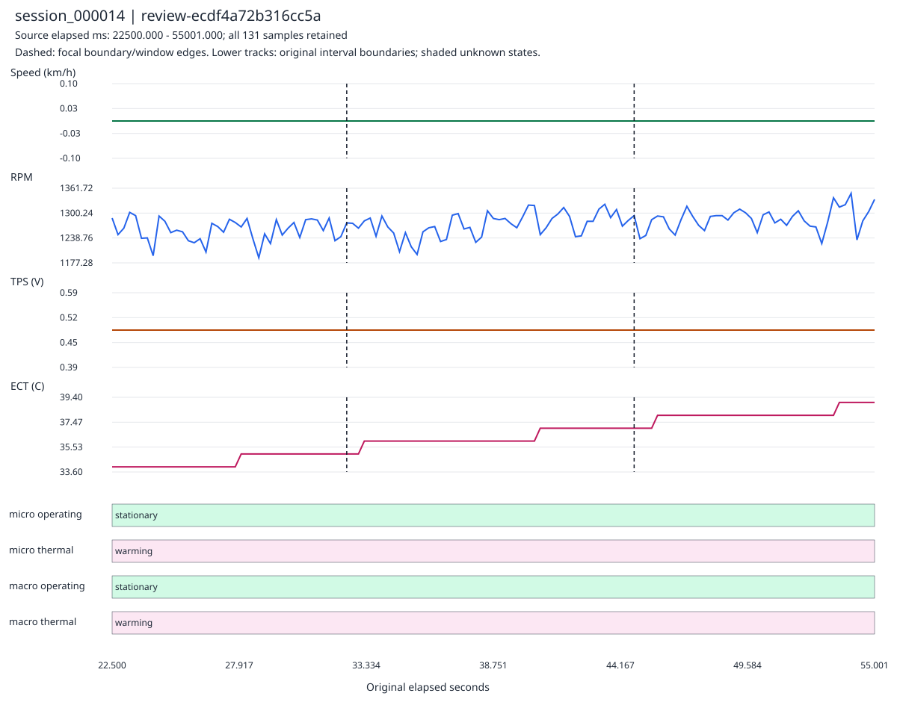

| Track | Label | Original Interval s | Interval ID |
| --- | --- | --- | --- |
| micro_operating | stationary_running | 0.0000-227.6250 | `auto_suggest_7cd371104465585120a4` |
| micro_thermal | warming | 0.0000-227.6250 | `auto_suggest_7cd371104465585120a4` |
| macro_operating | stationary_running | 0.0000-297.8760 | `macro-1fcb6bc0ed2fd1af60691421` |
| macro_thermal | warming | 0.0000-227.6250 | `macro-d58c92d2dcce8a9bea57e52e` |

Action: **pending**. Human review seconds: **not recorded**.

## 02: session_000015 / review-b145cb9ed5720579

Source SHA-256: `ef4362cc2350e8047eab72c91346b6cefb1b4ef4a3a50419ec3a57ba685e0f39`

Evidence: 0.000-29751.000 ms; indices 0-119 inclusive.
Focus: 7.5010-19.7490 s. Selection: Seeded random window for operating context coverage: stationary_running.

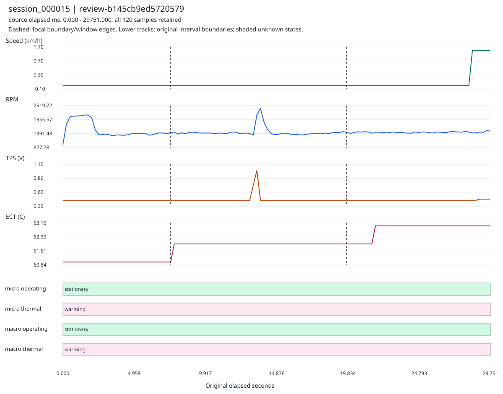

| Track | Label | Original Interval s | Interval ID |
| --- | --- | --- | --- |
| micro_operating | stationary_running | 0.0000-30.1250 | `auto_suggest_e51eec207ea53c244513` |
| micro_thermal | warming | 0.0000-30.1250 | `auto_suggest_e51eec207ea53c244513` |
| macro_operating | stationary_running | 0.0000-30.1250 | `macro-8b64e9af045f75b05569338f` |
| macro_thermal | warming | 0.0000-132.5010 | `macro-b30ee5e68ea8fcb860b0acdb` |

Action: **pending**. Human review seconds: **not recorded**.

## 03: session_000002 / review-9c8d1be35320c570

Source SHA-256: `19071f9dac5a874ca4245233a3bb94770dc34d8db10a1dfa54fbf6cdb29c5eaa`

Evidence: 1251252.000-1284001.000 ms; indices 4999-5130 inclusive.
Focus: 1261.5010-1273.7530 s. Selection: Seeded random window for thermal context coverage: stable.

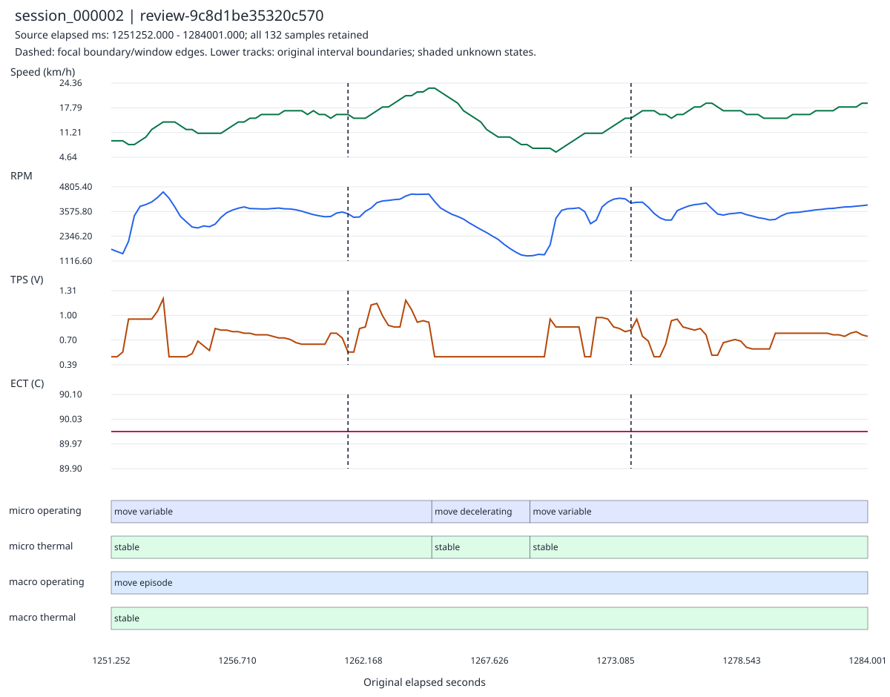

| Track | Label | Original Interval s | Interval ID |
| --- | --- | --- | --- |
| micro_operating | moving_variable | 1244.1265-1265.1265 | `auto_suggest_3e50d99f1a2e03cd559e` |
| micro_operating | moving_decelerating | 1265.1265-1269.3765 | `auto_suggest_a195748880efaca62a6b` |
| micro_operating | moving_variable | 1269.3765-1284.8770 | `auto_suggest_71411283ebed54539b98` |
| micro_thermal | stable | 1244.1265-1265.1265 | `auto_suggest_3e50d99f1a2e03cd559e` |
| micro_thermal | stable | 1265.1265-1269.3765 | `auto_suggest_a195748880efaca62a6b` |
| micro_thermal | stable | 1269.3765-1284.8770 | `auto_suggest_71411283ebed54539b98` |
| macro_operating | moving_episode | 1244.1265-1284.8770 | `macro-faf2285fb98ffda991d2bbad` |
| macro_thermal | stable | 1219.1260-1428.3760 | `macro-3d8bb9dbfe95e965bba5aa01` |

Action: **pending**. Human review seconds: **not recorded**.

## 04: session_000006 / review-55e708928648e069

Source SHA-256: `61d64e80833db597b4e10725bbc12dc6eb844157e6fc3db52ceaaeb33b45ffb9`

Evidence: 117748.000-150001.000 ms; indices 470-599 inclusive.
Focus: 127.7500-140.0000 s. Selection: Seeded random window for operating context coverage: stationary_running.

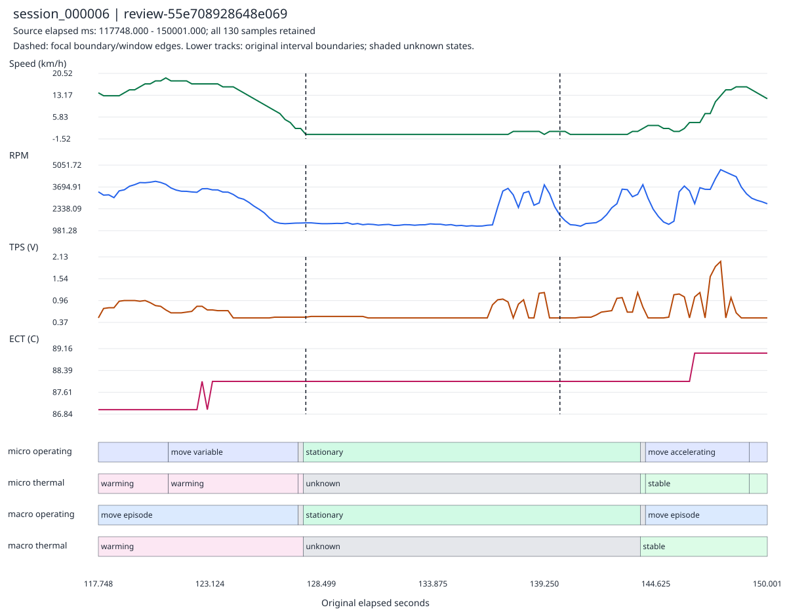

| Track | Label | Original Interval s | Interval ID |
| --- | --- | --- | --- |
| micro_operating | moving_accelerating | 116.8750-121.1240 | `auto_suggest_a674a67b2ebcb80c285c` |
| micro_operating | moving_variable | 121.1240-127.3745 | `auto_suggest_9e3fa0ca8971e17744a5` |
| micro_operating | unknown | 127.3745-127.6255 | `auto_suggest_6e4ee339637ccc87b5dc` |
| micro_operating | stationary_running | 127.6255-143.8745 | `auto_suggest_8f376a71a3a7bdb23cdd` |
| micro_operating | unknown | 143.8745-144.1250 | `auto_suggest_5bb2101aefd95f564692` |
| micro_operating | moving_accelerating | 144.1250-149.1250 | `auto_suggest_1ffefcb2923d7455fd9d` |
| micro_operating | moving_variable | 149.1250-180.8745 | `auto_suggest_a66443bd0ace7315adb5` |
| micro_thermal | warming | 116.8750-121.1240 | `auto_suggest_a674a67b2ebcb80c285c` |
| micro_thermal | warming | 121.1240-127.3745 | `auto_suggest_9e3fa0ca8971e17744a5` |
| micro_thermal | warming | 127.3745-127.6255 | `auto_suggest_6e4ee339637ccc87b5dc` |
| micro_thermal | unknown | 127.6255-143.8745 | `auto_suggest_8f376a71a3a7bdb23cdd` |
| micro_thermal | stable | 143.8745-144.1250 | `auto_suggest_5bb2101aefd95f564692` |
| micro_thermal | stable | 144.1250-149.1250 | `auto_suggest_1ffefcb2923d7455fd9d` |
| micro_thermal | stable | 149.1250-180.8745 | `auto_suggest_a66443bd0ace7315adb5` |
| macro_operating | moving_episode | 53.6245-127.3745 | `macro-3fa0a2d730a9a4097c1a2db6` |
| macro_operating | unknown | 127.3745-127.6255 | `macro-265a03f73476315d04aee9c1` |
| macro_operating | stationary_running | 127.6255-143.8745 | `macro-4cd64ab7251af6e6b10bc32f` |
| macro_operating | unknown | 143.8745-144.1250 | `macro-b1a7272198d21477847c0b1b` |
| macro_operating | moving_episode | 144.1250-219.3750 | `macro-7ba539ef923d94aff8a0c47b` |
| macro_thermal | warming | 0.0000-127.6255 | `macro-269dd46d9f561e435d5b831c` |
| macro_thermal | unknown | 127.6255-143.8745 | `macro-ae88860d3e61004cdf127c7e` |
| macro_thermal | stable | 143.8745-230.7500 | `macro-f848219eedf74b3345174b9e` |

Action: **pending**. Human review seconds: **not recorded**.

## 05: session_000005 / review-d39d0fc302d785ee

Source SHA-256: `260b706c68fc4807cf23ddb8977059ca3523d77c105d7f27093354b9d7072be4`

Evidence: 738250.000-758499.000 ms; indices 2952-3033 inclusive.
Focus: 748.3730-748.3730 s. Selection: Seeded random boundary for thermal context coverage.

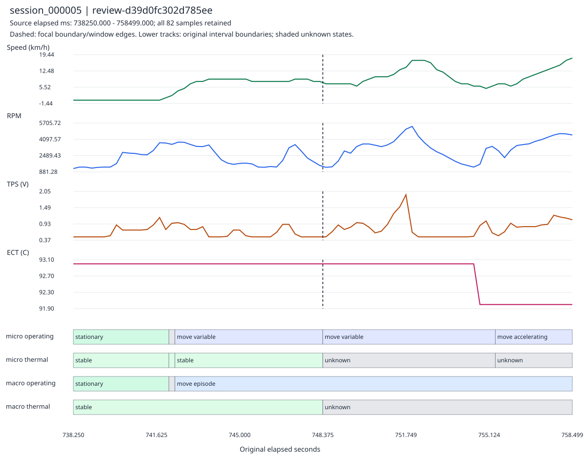

| Track | Label | Original Interval s | Interval ID |
| --- | --- | --- | --- |
| micro_operating | stationary_running | 726.3735-742.1235 | `auto_suggest_81622c564843037dd781` |
| micro_operating | unknown | 742.1235-742.3740 | `auto_suggest_f028932910afd796295a` |
| micro_operating | moving_variable | 742.3740-748.3730 | `auto_suggest_3515c42b7bc1236c8bbd` |
| micro_operating | moving_variable | 748.3730-755.3740 | `auto_suggest_4280d02a72f9579d792e` |
| micro_operating | moving_accelerating | 755.3740-760.8740 | `auto_suggest_259d3c04cd67ff809fca` |
| micro_thermal | stable | 726.3735-742.1235 | `auto_suggest_81622c564843037dd781` |
| micro_thermal | stable | 742.1235-742.3740 | `auto_suggest_f028932910afd796295a` |
| micro_thermal | stable | 742.3740-748.3730 | `auto_suggest_3515c42b7bc1236c8bbd` |
| micro_thermal | unknown | 748.3730-755.3740 | `auto_suggest_4280d02a72f9579d792e` |
| micro_thermal | unknown | 755.3740-760.8740 | `auto_suggest_259d3c04cd67ff809fca` |
| macro_operating | stationary_running | 696.3725-742.1235 | `macro-3ea052299ccdf32c70e4496d` |
| macro_operating | unknown | 742.1235-742.3740 | `macro-5fc41acbebb911934eb88dee` |
| macro_operating | moving_episode | 742.3740-1016.8740 | `macro-ba18b23a4b35edd6837dfe09` |
| macro_thermal | stable | 726.3735-748.3730 | `macro-7d23f101d4f0a84b3056691b` |
| macro_thermal | unknown | 748.3730-788.3740 | `macro-23ee3d5239cee796d12369bb` |

Action: **pending**. Human review seconds: **not recorded**.

## 06: session_000006 / review-fbe8f1a185598a43

Source SHA-256: `61d64e80833db597b4e10725bbc12dc6eb844157e6fc3db52ceaaeb33b45ffb9`

Evidence: 209250.000-229498.000 ms; indices 836-917 inclusive.
Focus: 219.3750-219.3750 s. Selection: Seeded random boundary for operating context coverage.

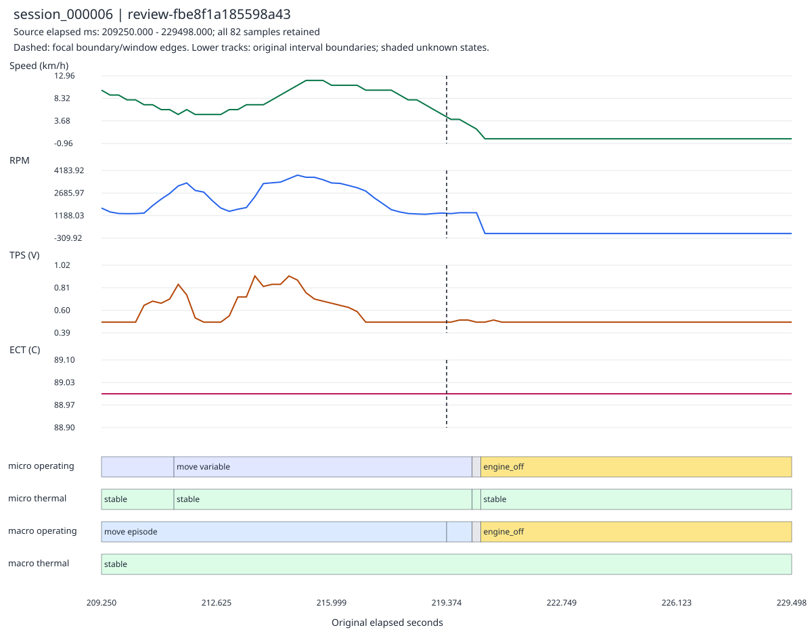

| Track | Label | Original Interval s | Interval ID |
| --- | --- | --- | --- |
| micro_operating | moving_decelerating | 206.8735-211.3750 | `auto_suggest_18730805dcf2e5bf811f` |
| micro_operating | moving_variable | 211.3750-220.1250 | `auto_suggest_9b09bfb9e2688bb74045` |
| micro_operating | unknown | 220.1250-220.3750 | `auto_suggest_1affb67004f4348a94a4` |
| micro_operating | engine_off | 220.3750-230.7500 | `auto_suggest_174628e0a89537a2092d` |
| micro_thermal | stable | 206.8735-211.3750 | `auto_suggest_18730805dcf2e5bf811f` |
| micro_thermal | stable | 211.3750-220.1250 | `auto_suggest_9b09bfb9e2688bb74045` |
| micro_thermal | stable | 220.1250-220.3750 | `auto_suggest_1affb67004f4348a94a4` |
| micro_thermal | stable | 220.3750-230.7500 | `auto_suggest_174628e0a89537a2092d` |
| macro_operating | moving_episode | 144.1250-219.3750 | `macro-7ba539ef923d94aff8a0c47b` |
| macro_operating | moving_episode | 219.3750-220.1250 | `macro-601b803c6016f88f8d9ff2d1` |
| macro_operating | unknown | 220.1250-220.3750 | `macro-08ea17e75b4a7ce0ed87b924` |
| macro_operating | engine_off | 220.3750-230.7500 | `macro-27d855ea8deebcbdaff9a533` |
| macro_thermal | stable | 143.8745-230.7500 | `macro-f848219eedf74b3345174b9e` |

Action: **pending**. Human review seconds: **not recorded**.

## 07: session_000004 / review-471eead27b3d5173

Source SHA-256: `8fe7ee4652a9154007eed9d04d199911c909d13327b0f5bf90c7f3bddb34a0d7`

Evidence: 547751.000-568000.000 ms; indices 2187-2268 inclusive.
Focus: 557.8750-557.8750 s. Selection: Seeded random boundary for operating context coverage: stationary_running.

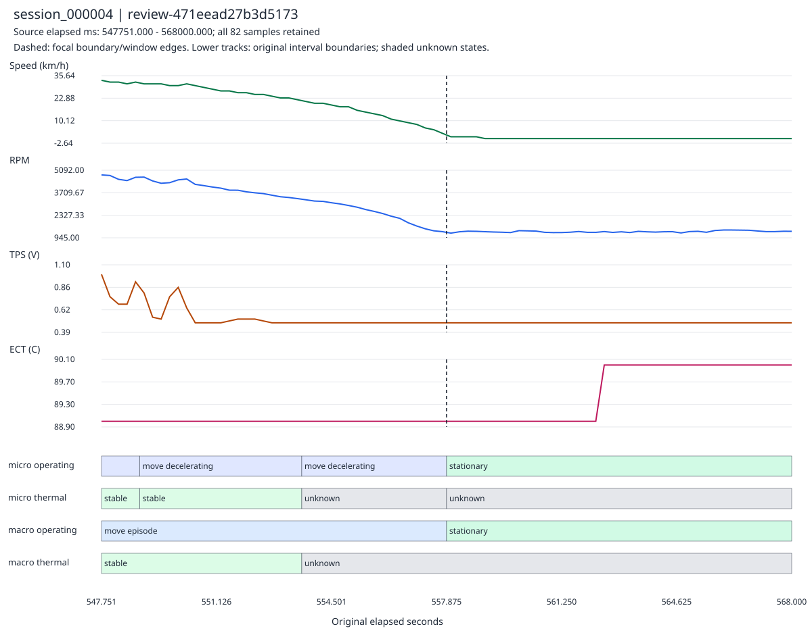

| Track | Label | Original Interval s | Interval ID |
| --- | --- | --- | --- |
| micro_operating | moving_variable | 543.8760-548.8750 | `auto_suggest_35d5cb9b5c93a606949d` |
| micro_operating | moving_decelerating | 548.8750-553.6265 | `auto_suggest_e9767ba6b47dd5007da5` |
| micro_operating | moving_decelerating | 553.6265-557.8750 | `auto_suggest_1d4490ce9af7b5490bf9` |
| micro_operating | stationary_running | 557.8750-573.6260 | `auto_suggest_e9113a1e753d3c9b40c9` |
| micro_thermal | stable | 543.8760-548.8750 | `auto_suggest_35d5cb9b5c93a606949d` |
| micro_thermal | stable | 548.8750-553.6265 | `auto_suggest_e9767ba6b47dd5007da5` |
| micro_thermal | unknown | 553.6265-557.8750 | `auto_suggest_1d4490ce9af7b5490bf9` |
| micro_thermal | unknown | 557.8750-573.6260 | `auto_suggest_e9113a1e753d3c9b40c9` |
| macro_operating | moving_episode | 428.6260-557.8750 | `macro-100ff4c5c125cc804e73178a` |
| macro_operating | stationary_running | 557.8750-580.6260 | `macro-c7ffef1510ffb79bd6978167` |
| macro_thermal | stable | 428.6260-553.6265 | `macro-e3eb9006ebb4c60e14c94e6d` |
| macro_thermal | unknown | 553.6265-573.6260 | `macro-c11087e5b3e8c92145611378` |

Action: **pending**. Human review seconds: **not recorded**.

## 08: session_000014 / review-d877d29270026221

Source SHA-256: `88245a15180859689db636159008582db646071e03c9d4eacb69476a7e95d8d6`

Evidence: 288000.000-300500.000 ms; indices 1151-1201 inclusive.
Focus: 298.1265-298.1265 s. Selection: Seeded random boundary for operating context coverage.

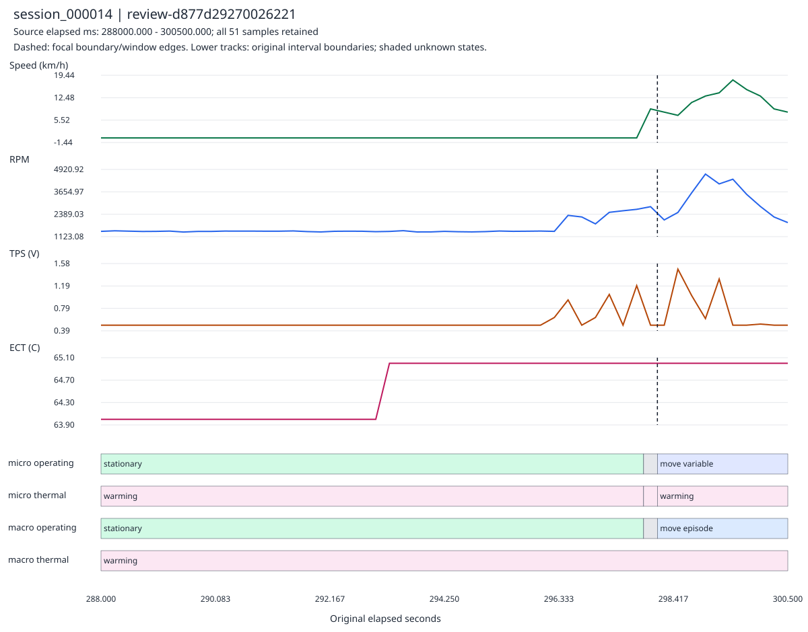

| Track | Label | Original Interval s | Interval ID |
| --- | --- | --- | --- |
| micro_operating | stationary_running | 232.3755-297.8760 | `auto_suggest_9a90a180e507678ac7d6` |
| micro_operating | unknown | 297.8760-298.1265 | `auto_suggest_31f01d533fea0c123c0e` |
| micro_operating | moving_variable | 298.1265-300.5000 | `auto_suggest_dd9a10bc5bb3cbff7eba` |
| micro_thermal | warming | 232.3755-297.8760 | `auto_suggest_9a90a180e507678ac7d6` |
| micro_thermal | warming | 297.8760-298.1265 | `auto_suggest_31f01d533fea0c123c0e` |
| micro_thermal | warming | 298.1265-300.5000 | `auto_suggest_dd9a10bc5bb3cbff7eba` |
| macro_operating | stationary_running | 0.0000-297.8760 | `macro-1fcb6bc0ed2fd1af60691421` |
| macro_operating | unknown | 297.8760-298.1265 | `macro-b684251f2476ef15463c2d08` |
| macro_operating | moving_episode | 298.1265-300.5000 | `macro-24f0880e4ac3cdc6ceda71c5` |
| macro_thermal | warming | 232.3755-300.5000 | `macro-892e3e8c86623fa188242c47` |

Action: **pending**. Human review seconds: **not recorded**.

## 09: session_000015 / review-3e761464f6ba6088

Source SHA-256: `ef4362cc2350e8047eab72c91346b6cefb1b4ef4a3a50419ec3a57ba685e0f39`

Evidence: 29751.000-62250.000 ms; indices 119-249 inclusive.
Focus: 39.9990-52.2500 s. Selection: Seeded random window for operating context coverage: moving_episode.

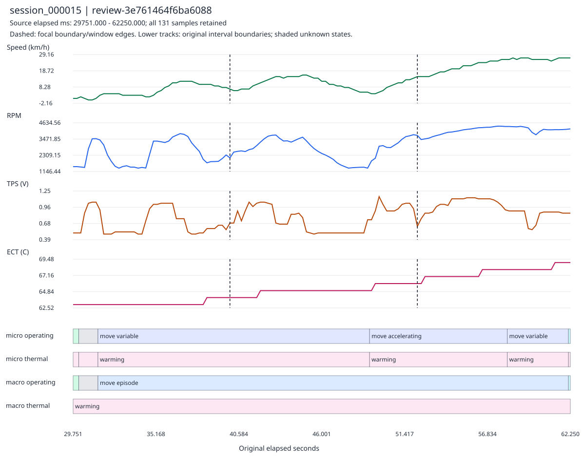

| Track | Label | Original Interval s | Interval ID |
| --- | --- | --- | --- |
| micro_operating | stationary_running | 0.0000-30.1250 | `auto_suggest_e51eec207ea53c244513` |
| micro_operating | unknown | 30.1250-31.3750 | `auto_suggest_e4d7152a7aef30b947c1` |
| micro_operating | moving_variable | 31.3750-49.1250 | `auto_suggest_0f938593fb2dc435e746` |
| micro_operating | moving_accelerating | 49.1250-58.1245 | `auto_suggest_655e4545c331deecfa76` |
| micro_operating | moving_variable | 58.1245-62.1245 | `auto_suggest_5fa459eb4d7a658495e5` |
| micro_operating | moving_steady | 62.1245-68.8755 | `auto_suggest_fc23f832ad9b7027ccc3` |
| micro_thermal | warming | 0.0000-30.1250 | `auto_suggest_e51eec207ea53c244513` |
| micro_thermal | warming | 30.1250-31.3750 | `auto_suggest_e4d7152a7aef30b947c1` |
| micro_thermal | warming | 31.3750-49.1250 | `auto_suggest_0f938593fb2dc435e746` |
| micro_thermal | warming | 49.1250-58.1245 | `auto_suggest_655e4545c331deecfa76` |
| micro_thermal | warming | 58.1245-62.1245 | `auto_suggest_5fa459eb4d7a658495e5` |
| micro_thermal | warming | 62.1245-68.8755 | `auto_suggest_fc23f832ad9b7027ccc3` |
| macro_operating | stationary_running | 0.0000-30.1250 | `macro-8b64e9af045f75b05569338f` |
| macro_operating | unknown | 30.1250-31.3750 | `macro-a879b6ed97316b06f0db94df` |
| macro_operating | moving_episode | 31.3750-62.1245 | `macro-84007601603c24a02b2ce159` |
| macro_operating | moving_steady | 62.1245-68.8755 | `macro-77a6c3fa8142f47e91c889ce` |
| macro_thermal | warming | 0.0000-132.5010 | `macro-b30ee5e68ea8fcb860b0acdb` |

Action: **pending**. Human review seconds: **not recorded**.

## 10: session_000015 / review-0c487f71621b8788

Source SHA-256: `ef4362cc2350e8047eab72c91346b6cefb1b4ef4a3a50419ec3a57ba685e0f39`

Evidence: 52001.000-72251.000 ms; indices 208-289 inclusive.
Focus: 62.1245-62.1245 s. Selection: Seeded random boundary for operating context coverage.

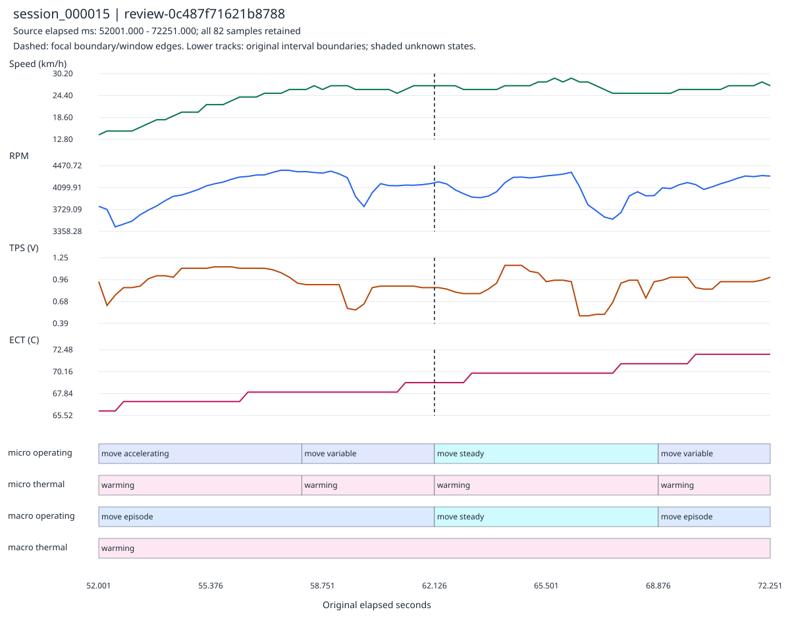

| Track | Label | Original Interval s | Interval ID |
| --- | --- | --- | --- |
| micro_operating | moving_accelerating | 49.1250-58.1245 | `auto_suggest_655e4545c331deecfa76` |
| micro_operating | moving_variable | 58.1245-62.1245 | `auto_suggest_5fa459eb4d7a658495e5` |
| micro_operating | moving_steady | 62.1245-68.8755 | `auto_suggest_fc23f832ad9b7027ccc3` |
| micro_operating | moving_variable | 68.8755-75.8745 | `auto_suggest_c3894825ef71090b9940` |
| micro_thermal | warming | 49.1250-58.1245 | `auto_suggest_655e4545c331deecfa76` |
| micro_thermal | warming | 58.1245-62.1245 | `auto_suggest_5fa459eb4d7a658495e5` |
| micro_thermal | warming | 62.1245-68.8755 | `auto_suggest_fc23f832ad9b7027ccc3` |
| micro_thermal | warming | 68.8755-75.8745 | `auto_suggest_c3894825ef71090b9940` |
| macro_operating | moving_episode | 31.3750-62.1245 | `macro-84007601603c24a02b2ce159` |
| macro_operating | moving_steady | 62.1245-68.8755 | `macro-77a6c3fa8142f47e91c889ce` |
| macro_operating | moving_episode | 68.8755-98.8750 | `macro-c84927acc2e4cb6e999b030a` |
| macro_thermal | warming | 0.0000-132.5010 | `macro-b30ee5e68ea8fcb860b0acdb` |

Action: **pending**. Human review seconds: **not recorded**.

## 11: session_000005 / review-85eaf4d810a95620

Source SHA-256: `260b706c68fc4807cf23ddb8977059ca3523d77c105d7f27093354b9d7072be4`

Evidence: 1743248.000-1775749.000 ms; indices 6969-7099 inclusive.
Focus: 1753.4980-1765.7480 s. Selection: Seeded random window for thermal context coverage: stable.

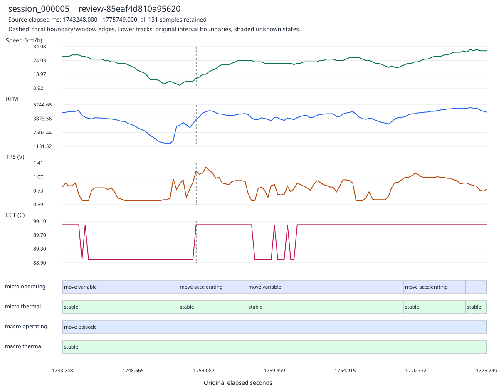

| Track | Label | Original Interval s | Interval ID |
| --- | --- | --- | --- |
| micro_operating | moving_variable | 1735.6235-1752.1235 | `auto_suggest_e0abc2203958e34b65cd` |
| micro_operating | moving_accelerating | 1752.1235-1757.3735 | `auto_suggest_23ec112b6d6656fc8ff6` |
| micro_operating | moving_variable | 1757.3735-1769.3740 | `auto_suggest_d9b84cd06196c3f43586` |
| micro_operating | moving_accelerating | 1769.3740-1774.1240 | `auto_suggest_125f16fa4a3136fb9f09` |
| micro_operating | moving_variable | 1774.1240-1782.3740 | `auto_suggest_f1955f3ac0ad323e9e97` |
| micro_thermal | stable | 1735.6235-1752.1235 | `auto_suggest_e0abc2203958e34b65cd` |
| micro_thermal | stable | 1752.1235-1757.3735 | `auto_suggest_23ec112b6d6656fc8ff6` |
| micro_thermal | stable | 1757.3735-1769.3740 | `auto_suggest_d9b84cd06196c3f43586` |
| micro_thermal | stable | 1769.3740-1774.1240 | `auto_suggest_125f16fa4a3136fb9f09` |
| micro_thermal | stable | 1774.1240-1782.3740 | `auto_suggest_f1955f3ac0ad323e9e97` |
| macro_operating | moving_episode | 1714.1245-1839.6230 | `macro-1a8a8e75ee7a03249dc4c953` |
| macro_thermal | stable | 1254.8735-1963.9970 | `macro-9fbf89cab4a2253770b494b8` |

Action: **pending**. Human review seconds: **not recorded**.

## 12: session_000023 / review-caa3b7ef3a040c22

Source SHA-256: `f034aa1aba5d36cca1f4e99c43b94e5cb298181e86dd74125c8f10d45d883e5a`

Evidence: 2706421.000-2738922.000 ms; indices 10819-10949 inclusive.
Focus: 2716.6710-2728.9210 s. Selection: Seeded random window for operating context coverage: moving_episode.

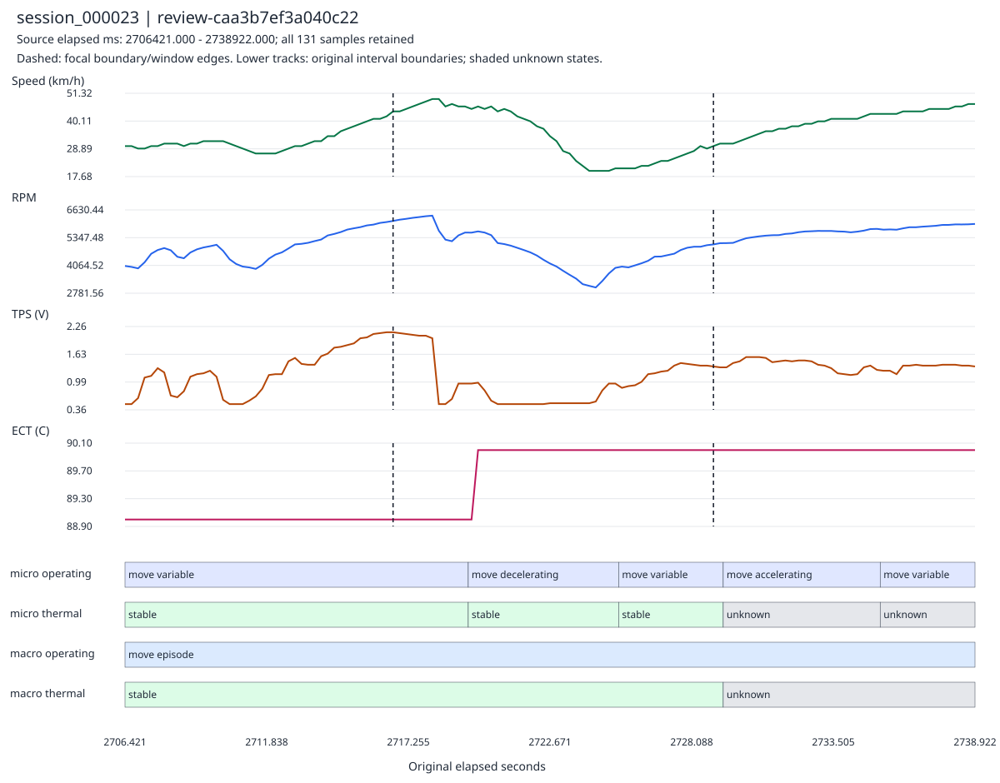

| Track | Label | Original Interval s | Interval ID |
| --- | --- | --- | --- |
| micro_operating | moving_variable | 2691.0465-2719.5465 | `auto_suggest_cadb39d137f4fa4d2d21` |
| micro_operating | moving_decelerating | 2719.5465-2725.2960 | `auto_suggest_32114a953a8bf78caac7` |
| micro_operating | moving_variable | 2725.2960-2729.2960 | `auto_suggest_43f1d131e927ddd54a99` |
| micro_operating | moving_accelerating | 2729.2960-2735.2970 | `auto_suggest_d7c26ed49ad0b6758317` |
| micro_operating | moving_variable | 2735.2970-2739.2970 | `auto_suggest_3ba6d5604cef252e5d27` |
| micro_thermal | stable | 2691.0465-2719.5465 | `auto_suggest_cadb39d137f4fa4d2d21` |
| micro_thermal | stable | 2719.5465-2725.2960 | `auto_suggest_32114a953a8bf78caac7` |
| micro_thermal | stable | 2725.2960-2729.2960 | `auto_suggest_43f1d131e927ddd54a99` |
| micro_thermal | unknown | 2729.2960-2735.2970 | `auto_suggest_d7c26ed49ad0b6758317` |
| micro_thermal | unknown | 2735.2970-2739.2970 | `auto_suggest_3ba6d5604cef252e5d27` |
| macro_operating | moving_episode | 2633.2975-2873.7970 | `macro-44c6520697fd730f4e4f4004` |
| macro_thermal | stable | 2673.7975-2729.2960 | `macro-01bfda0032d4bc1b54e20132` |
| macro_thermal | unknown | 2729.2960-2772.5465 | `macro-cff459ab19724cc2abffdfa4` |

Action: **pending**. Human review seconds: **not recorded**.

## 13: session_000006 / review-75c21fcff9874f70

Source SHA-256: `61d64e80833db597b4e10725bbc12dc6eb844157e6fc3db52ceaaeb33b45ffb9`

Evidence: 133749.000-153999.000 ms; indices 534-615 inclusive.
Focus: 143.8745-143.8745 s. Selection: Seeded random boundary for thermal context coverage.

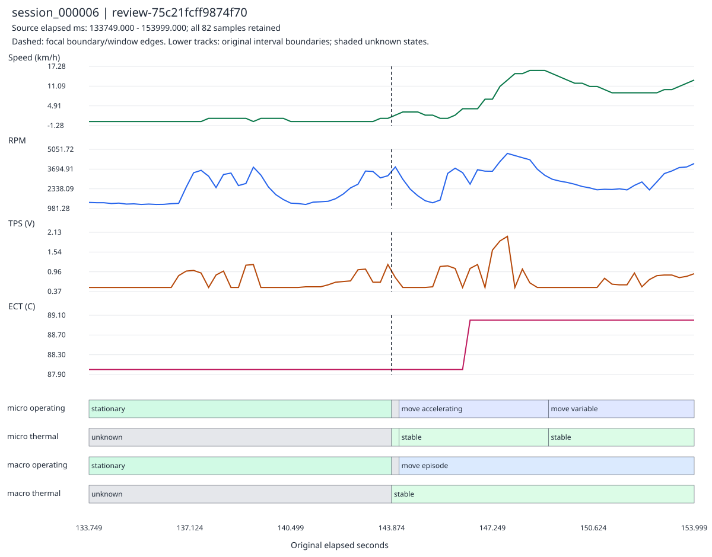

| Track | Label | Original Interval s | Interval ID |
| --- | --- | --- | --- |
| micro_operating | stationary_running | 127.6255-143.8745 | `auto_suggest_8f376a71a3a7bdb23cdd` |
| micro_operating | unknown | 143.8745-144.1250 | `auto_suggest_5bb2101aefd95f564692` |
| micro_operating | moving_accelerating | 144.1250-149.1250 | `auto_suggest_1ffefcb2923d7455fd9d` |
| micro_operating | moving_variable | 149.1250-180.8745 | `auto_suggest_a66443bd0ace7315adb5` |
| micro_thermal | unknown | 127.6255-143.8745 | `auto_suggest_8f376a71a3a7bdb23cdd` |
| micro_thermal | stable | 143.8745-144.1250 | `auto_suggest_5bb2101aefd95f564692` |
| micro_thermal | stable | 144.1250-149.1250 | `auto_suggest_1ffefcb2923d7455fd9d` |
| micro_thermal | stable | 149.1250-180.8745 | `auto_suggest_a66443bd0ace7315adb5` |
| macro_operating | stationary_running | 127.6255-143.8745 | `macro-4cd64ab7251af6e6b10bc32f` |
| macro_operating | unknown | 143.8745-144.1250 | `macro-b1a7272198d21477847c0b1b` |
| macro_operating | moving_episode | 144.1250-219.3750 | `macro-7ba539ef923d94aff8a0c47b` |
| macro_thermal | unknown | 127.6255-143.8745 | `macro-ae88860d3e61004cdf127c7e` |
| macro_thermal | stable | 143.8745-230.7500 | `macro-f848219eedf74b3345174b9e` |

Action: **pending**. Human review seconds: **not recorded**.

## 14: session_000014 / review-c82effcc6e221012

Source SHA-256: `88245a15180859689db636159008582db646071e03c9d4eacb69476a7e95d8d6`

Evidence: 222250.000-242500.000 ms; indices 889-970 inclusive.
Focus: 232.3755-232.3755 s. Selection: Seeded random boundary for thermal context coverage.

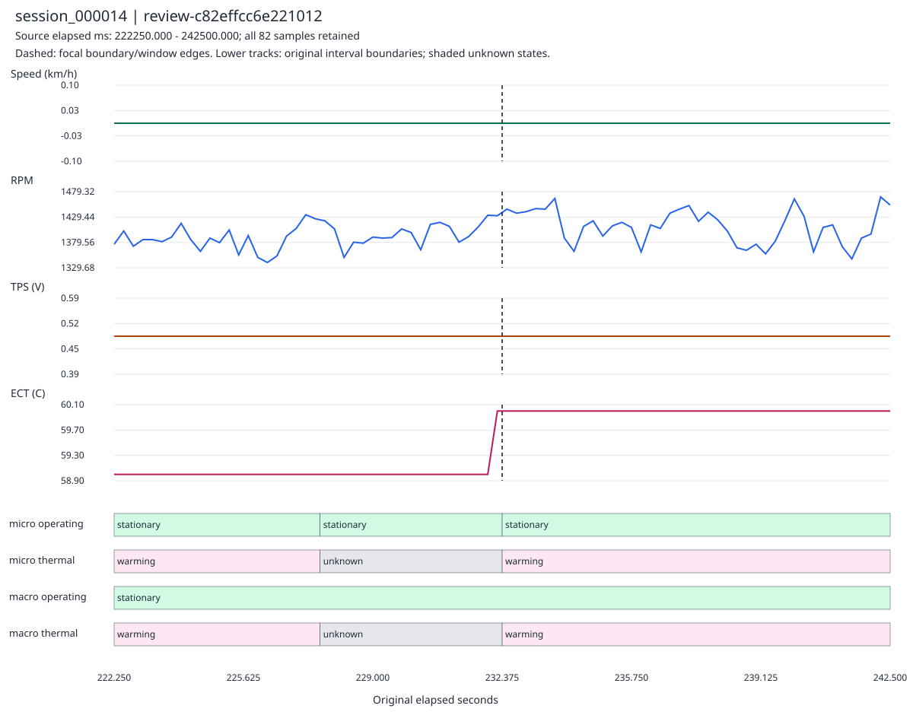

| Track | Label | Original Interval s | Interval ID |
| --- | --- | --- | --- |
| micro_operating | stationary_running | 0.0000-227.6250 | `auto_suggest_7cd371104465585120a4` |
| micro_operating | stationary_running | 227.6250-232.3755 | `auto_suggest_8d67b7ee48de49d7c803` |
| micro_operating | stationary_running | 232.3755-297.8760 | `auto_suggest_9a90a180e507678ac7d6` |
| micro_thermal | warming | 0.0000-227.6250 | `auto_suggest_7cd371104465585120a4` |
| micro_thermal | unknown | 227.6250-232.3755 | `auto_suggest_8d67b7ee48de49d7c803` |
| micro_thermal | warming | 232.3755-297.8760 | `auto_suggest_9a90a180e507678ac7d6` |
| macro_operating | stationary_running | 0.0000-297.8760 | `macro-1fcb6bc0ed2fd1af60691421` |
| macro_thermal | warming | 0.0000-227.6250 | `macro-d58c92d2dcce8a9bea57e52e` |
| macro_thermal | unknown | 227.6250-232.3755 | `macro-13f1ff34ac4e56cea73ad672` |
| macro_thermal | warming | 232.3755-300.5000 | `macro-892e3e8c86623fa188242c47` |

Action: **pending**. Human review seconds: **not recorded**.

## 15: session_000007 / review-6c6b9b46b830677d

Source SHA-256: `509cc87f61d71f39f7ca4f0651424d1ba73dc15b97f49325b7586dcbbec77879`

Evidence: 1205250.000-1225499.000 ms; indices 4818-4898 inclusive.
Focus: 1215.3765-1215.3765 s. Selection: Seeded random boundary for operating context coverage.

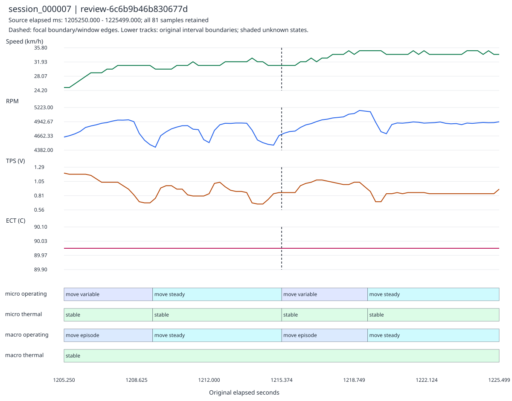

| Track | Label | Original Interval s | Interval ID |
| --- | --- | --- | --- |
| micro_operating | moving_variable | 1200.6265-1209.3760 | `auto_suggest_f6ee9daba4033fca4ce3` |
| micro_operating | moving_steady | 1209.3760-1215.3765 | `auto_suggest_ed97442d2b40c49d2a2e` |
| micro_operating | moving_variable | 1215.3765-1219.3765 | `auto_suggest_7db4ba8430020210629d` |
| micro_operating | moving_steady | 1219.3765-1232.8755 | `auto_suggest_39dc1a08b5d513c5cb5c` |
| micro_thermal | stable | 1200.6265-1209.3760 | `auto_suggest_f6ee9daba4033fca4ce3` |
| micro_thermal | stable | 1209.3760-1215.3765 | `auto_suggest_ed97442d2b40c49d2a2e` |
| micro_thermal | stable | 1215.3765-1219.3765 | `auto_suggest_7db4ba8430020210629d` |
| micro_thermal | stable | 1219.3765-1232.8755 | `auto_suggest_39dc1a08b5d513c5cb5c` |
| macro_operating | moving_episode | 953.6255-1209.3760 | `macro-52eae75c51922784f7ecd7f5` |
| macro_operating | moving_steady | 1209.3760-1215.3765 | `macro-e958daf533b4d5c083dee527` |
| macro_operating | moving_episode | 1215.3765-1219.3765 | `macro-fbdf2269359a5d49ba828fa0` |
| macro_operating | moving_steady | 1219.3765-1232.8755 | `macro-0ef6f8500e29dba753ef4ba1` |
| macro_thermal | stable | 982.1260-1580.8760 | `macro-f3c1b0bc5a1afbbb3e16fa14` |

Action: **pending**. Human review seconds: **not recorded**.

## 16: session_000023 / review-971e1e48c7f63cef

Source SHA-256: `f034aa1aba5d36cca1f4e99c43b94e5cb298181e86dd74125c8f10d45d883e5a`

Evidence: 4074172.000-4106673.000 ms; indices 16270-16400 inclusive.
Focus: 4084.1730-4096.4230 s. Selection: Seeded random window for operating context coverage: moving_steady.

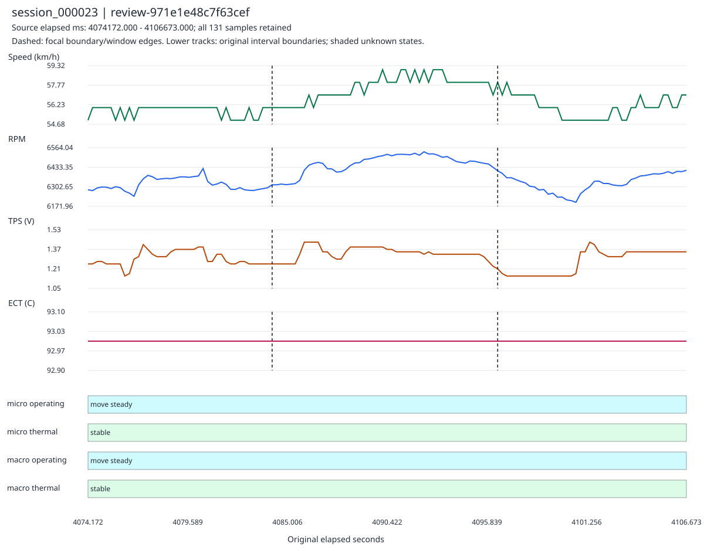

| Track | Label | Original Interval s | Interval ID |
| --- | --- | --- | --- |
| micro_operating | moving_steady | 4054.7975-4114.5475 | `auto_suggest_425cd1942a902750c3dc` |
| micro_thermal | stable | 4054.7975-4114.5475 | `auto_suggest_425cd1942a902750c3dc` |
| macro_operating | moving_steady | 4054.7975-4114.5475 | `macro-0b652271ee1ff4b1f96e7e7d` |
| macro_thermal | stable | 3524.0470-4244.7970 | `macro-a140f2d3c614138a9f924346` |

Action: **pending**. Human review seconds: **not recorded**.

## 17: session_000015 / review-2f23d6a693e395d2

Source SHA-256: `ef4362cc2350e8047eab72c91346b6cefb1b4ef4a3a50419ec3a57ba685e0f39`

Evidence: 95999.000-116249.000 ms; indices 384-465 inclusive.
Focus: 106.1255-106.1255 s. Selection: Seeded random boundary for operating context coverage.

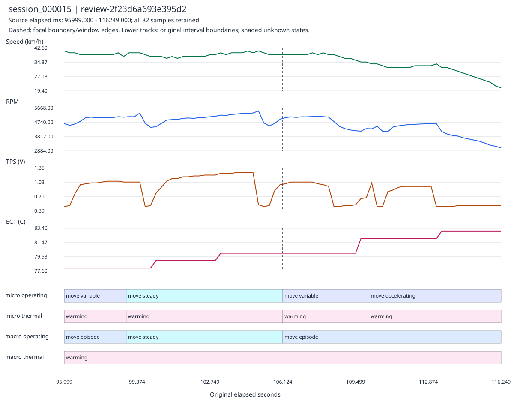

| Track | Label | Original Interval s | Interval ID |
| --- | --- | --- | --- |
| micro_operating | moving_variable | 94.3750-98.8750 | `auto_suggest_6fe2ca8351c973ea35c0` |
| micro_operating | moving_steady | 98.8750-106.1255 | `auto_suggest_0791db343b65d4c9988a` |
| micro_operating | moving_variable | 106.1255-110.1255 | `auto_suggest_962d8d7c8a24a62a8de0` |
| micro_operating | moving_decelerating | 110.1255-120.1240 | `auto_suggest_54d1a24f6cb45bf95b50` |
| micro_thermal | warming | 94.3750-98.8750 | `auto_suggest_6fe2ca8351c973ea35c0` |
| micro_thermal | warming | 98.8750-106.1255 | `auto_suggest_0791db343b65d4c9988a` |
| micro_thermal | warming | 106.1255-110.1255 | `auto_suggest_962d8d7c8a24a62a8de0` |
| micro_thermal | warming | 110.1255-120.1240 | `auto_suggest_54d1a24f6cb45bf95b50` |
| macro_operating | moving_episode | 68.8755-98.8750 | `macro-c84927acc2e4cb6e999b030a` |
| macro_operating | moving_steady | 98.8750-106.1255 | `macro-4edba87d01c0f83852cb017b` |
| macro_operating | moving_episode | 106.1255-120.1240 | `macro-42f06e098d5f5f970626c1b5` |
| macro_thermal | warming | 0.0000-132.5010 | `macro-b30ee5e68ea8fcb860b0acdb` |

Action: **pending**. Human review seconds: **not recorded**.

## 18: session_000002 / review-89da4ee6ec5daff2

Source SHA-256: `19071f9dac5a874ca4245233a3bb94770dc34d8db10a1dfa54fbf6cdb29c5eaa`

Evidence: 180501.000-200751.000 ms; indices 722-803 inclusive.
Focus: 190.6260-190.6260 s. Selection: Seeded random boundary for thermal context coverage.

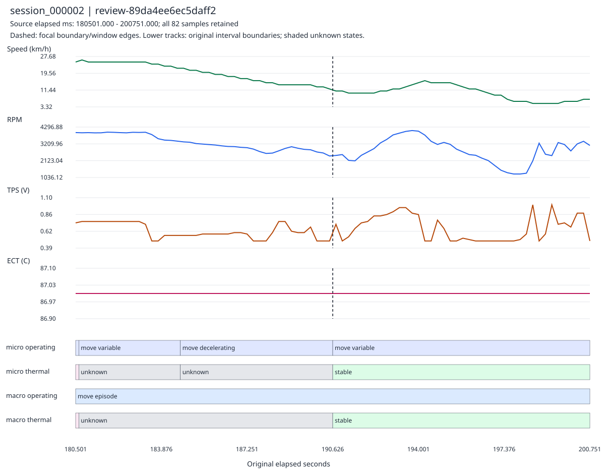

| Track | Label | Original Interval s | Interval ID |
| --- | --- | --- | --- |
| micro_operating | moving_decelerating | 176.1270-180.6260 | `auto_suggest_63b83c40f1200810c0c9` |
| micro_operating | moving_variable | 180.6260-184.6260 | `auto_suggest_200a5f913ae5a03106b1` |
| micro_operating | moving_decelerating | 184.6260-190.6260 | `auto_suggest_d0ec395a11b0dccfc118` |
| micro_operating | moving_variable | 190.6260-202.6265 | `auto_suggest_8967f4e57b8be5bd0d05` |
| micro_thermal | warming | 176.1270-180.6260 | `auto_suggest_63b83c40f1200810c0c9` |
| micro_thermal | unknown | 180.6260-184.6260 | `auto_suggest_200a5f913ae5a03106b1` |
| micro_thermal | unknown | 184.6260-190.6260 | `auto_suggest_d0ec395a11b0dccfc118` |
| micro_thermal | stable | 190.6260-202.6265 | `auto_suggest_8967f4e57b8be5bd0d05` |
| macro_operating | moving_episode | 124.3770-381.6270 | `macro-6dc5937a7f316360caecf1e4` |
| macro_thermal | warming | 0.0000-180.6260 | `macro-278bd8202b03978ebd4f2fee` |
| macro_thermal | unknown | 180.6260-190.6260 | `macro-ce992dfb1f75d49bfc73d3e1` |
| macro_thermal | stable | 190.6260-956.8770 | `macro-4dd376075f807e6c0ab58e63` |

Action: **pending**. Human review seconds: **not recorded**.

## 19: session_000007 / review-2a2dc9e63d3529fd

Source SHA-256: `509cc87f61d71f39f7ca4f0651424d1ba73dc15b97f49325b7586dcbbec77879`

Evidence: 827750.000-860251.000 ms; indices 3309-3439 inclusive.
Focus: 838.0000-850.2500 s. Selection: Seeded random window for operating context coverage: moving_episode.

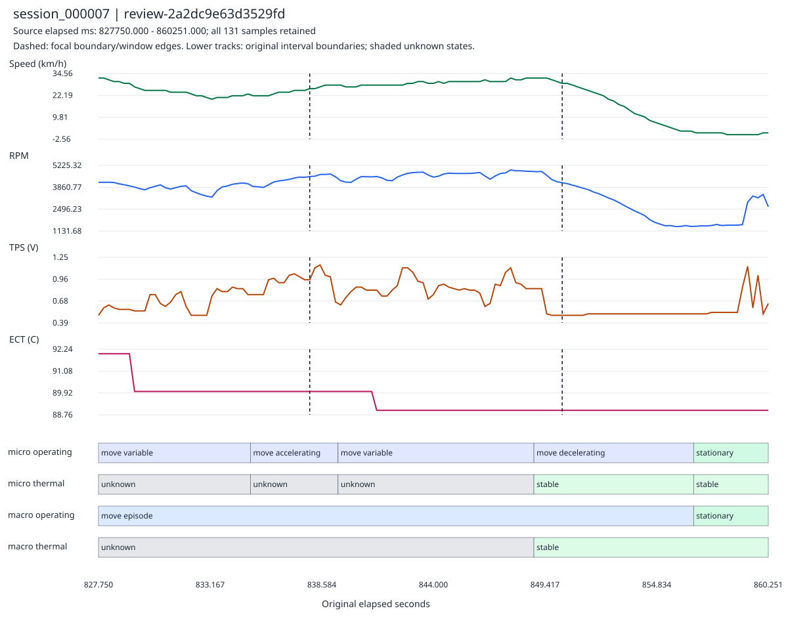

| Track | Label | Original Interval s | Interval ID |
| --- | --- | --- | --- |
| micro_operating | moving_variable | 823.6255-835.1255 | `auto_suggest_a7ea2af0326261ff6de9` |
| micro_operating | moving_accelerating | 835.1255-839.3760 | `auto_suggest_91841e01789e558e68bb` |
| micro_operating | moving_variable | 839.3760-848.8770 | `auto_suggest_7563225ccc34ec33204a` |
| micro_operating | moving_decelerating | 848.8770-856.6250 | `auto_suggest_5379219ba59f7d0752b4` |
| micro_operating | stationary_running | 856.6250-862.3750 | `auto_suggest_829751a9001ceaff1bcf` |
| micro_thermal | unknown | 823.6255-835.1255 | `auto_suggest_a7ea2af0326261ff6de9` |
| micro_thermal | unknown | 835.1255-839.3760 | `auto_suggest_91841e01789e558e68bb` |
| micro_thermal | unknown | 839.3760-848.8770 | `auto_suggest_7563225ccc34ec33204a` |
| micro_thermal | stable | 848.8770-856.6250 | `auto_suggest_5379219ba59f7d0752b4` |
| micro_thermal | stable | 856.6250-862.3750 | `auto_suggest_829751a9001ceaff1bcf` |
| macro_operating | moving_episode | 818.3760-856.6250 | `macro-df9e6e84e3149c572e157fb3` |
| macro_operating | stationary_running | 856.6250-862.3750 | `macro-5acc5a72c0993d6d86a1070b` |
| macro_thermal | unknown | 784.3755-848.8770 | `macro-8332a1451446ee435aaff99a` |
| macro_thermal | stable | 848.8770-915.6265 | `macro-b9e860050c8354cb920fcf61` |

Action: **pending**. Human review seconds: **not recorded**.

## 20: session_000018 / review-2fb214d237a8bb15

Source SHA-256: `6ef183818d3743c5bae2527928487f7f5991264f2f07528b965bddd0979e4b04`

Evidence: 2806252.000-2826501.000 ms; indices 11219-11300 inclusive.
Focus: 2816.3760-2816.3760 s. Selection: Seeded random boundary for operating context coverage.

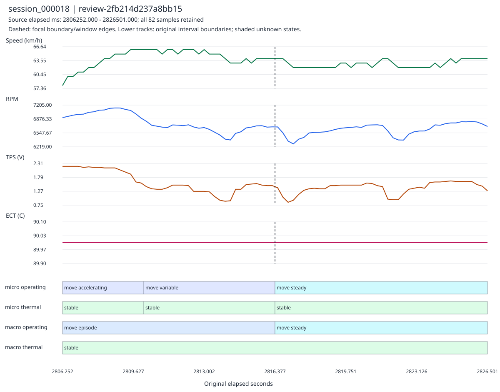

| Track | Label | Original Interval s | Interval ID |
| --- | --- | --- | --- |
| micro_operating | moving_accelerating | 2799.6260-2810.1250 | `auto_suggest_09c0e12467c411203e7c` |
| micro_operating | moving_variable | 2810.1250-2816.3760 | `auto_suggest_594f757fd15ef686e765` |
| micro_operating | moving_steady | 2816.3760-2831.1265 | `auto_suggest_72862496b60166161ea2` |
| micro_thermal | stable | 2799.6260-2810.1250 | `auto_suggest_09c0e12467c411203e7c` |
| micro_thermal | stable | 2810.1250-2816.3760 | `auto_suggest_594f757fd15ef686e765` |
| micro_thermal | stable | 2816.3760-2831.1265 | `auto_suggest_72862496b60166161ea2` |
| macro_operating | moving_episode | 2766.3750-2816.3760 | `macro-3b8fb41e68a18242d27cccb8` |
| macro_operating | moving_steady | 2816.3760-2831.1265 | `macro-6c4b15c5a7cdfbc653c53e26` |
| macro_thermal | stable | 459.8765-3115.1265 | `macro-57ee376e41c62c8897b5a654` |

Action: **pending**. Human review seconds: **not recorded**.

## 21: session_000007 / review-36b48001c2f6f5b6

Source SHA-256: `509cc87f61d71f39f7ca4f0651424d1ba73dc15b97f49325b7586dcbbec77879`

Evidence: 475250.000-507751.000 ms; indices 1899-2029 inclusive.
Focus: 485.5000-497.7500 s. Selection: Seeded random window for operating context coverage: moving_steady.

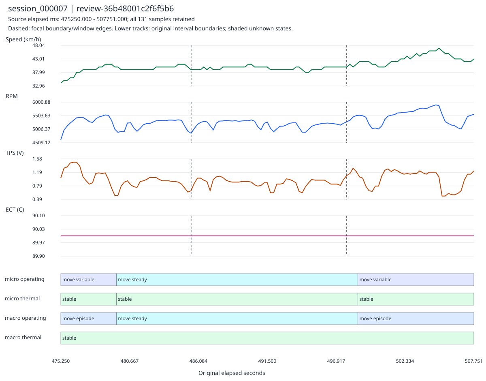

| Track | Label | Original Interval s | Interval ID |
| --- | --- | --- | --- |
| micro_operating | moving_variable | 473.1260-479.6260 | `auto_suggest_69eb451041748a649686` |
| micro_operating | moving_steady | 479.6260-498.6260 | `auto_suggest_6214c20b267358c68121` |
| micro_operating | moving_variable | 498.6260-525.1265 | `auto_suggest_708ac55288571db937de` |
| micro_thermal | stable | 473.1260-479.6260 | `auto_suggest_69eb451041748a649686` |
| micro_thermal | stable | 479.6260-498.6260 | `auto_suggest_6214c20b267358c68121` |
| micro_thermal | stable | 498.6260-525.1265 | `auto_suggest_708ac55288571db937de` |
| macro_operating | moving_episode | 473.1260-479.6260 | `macro-9804918ce7ce0399da4fa1e3` |
| macro_operating | moving_steady | 479.6260-498.6260 | `macro-33894425d210de47e441554c` |
| macro_operating | moving_episode | 498.6260-538.8760 | `macro-3cee2a12f4cd1c2425bd4f5f` |
| macro_thermal | stable | 0.0000-784.3755 | `macro-4695f405d86378e2400db249` |

Action: **pending**. Human review seconds: **not recorded**.

## 22: session_000023 / review-50d12ede234818d5

Source SHA-256: `f034aa1aba5d36cca1f4e99c43b94e5cb298181e86dd74125c8f10d45d883e5a`

Evidence: 344422.000-364672.000 ms; indices 1376-1457 inclusive.
Focus: 354.5465-354.5465 s. Selection: Seeded random boundary for operating context coverage.

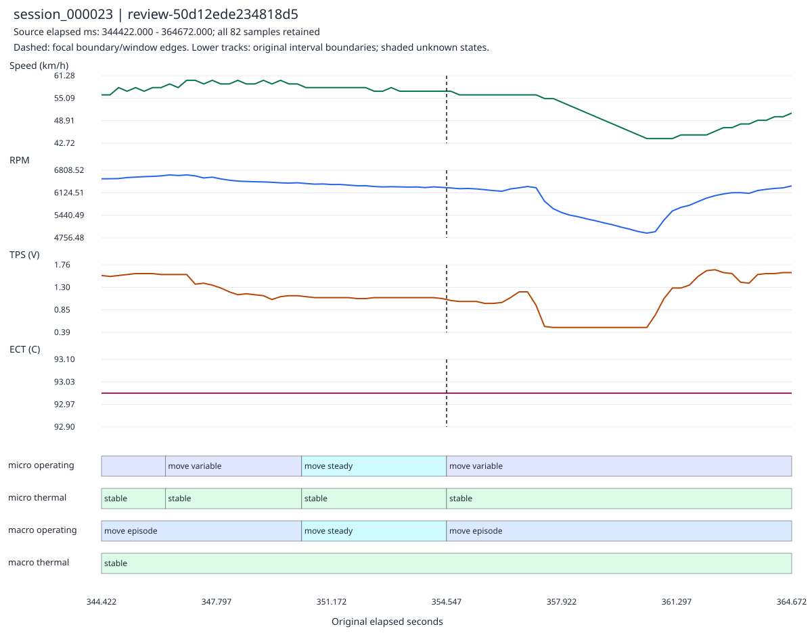

| Track | Label | Original Interval s | Interval ID |
| --- | --- | --- | --- |
| micro_operating | moving_accelerating | 341.7970-346.2960 | `auto_suggest_876e9fbe4caa35e6e907` |
| micro_operating | moving_variable | 346.2960-350.2960 | `auto_suggest_8044c6f7e94ab2c7ec70` |
| micro_operating | moving_steady | 350.2960-354.5465 | `auto_suggest_be160836fc399fb8fd62` |
| micro_operating | moving_variable | 354.5465-364.7975 | `auto_suggest_dcaef5d4ca84ba94a0e6` |
| micro_thermal | stable | 341.7970-346.2960 | `auto_suggest_876e9fbe4caa35e6e907` |
| micro_thermal | stable | 346.2960-350.2960 | `auto_suggest_8044c6f7e94ab2c7ec70` |
| micro_thermal | stable | 350.2960-354.5465 | `auto_suggest_be160836fc399fb8fd62` |
| micro_thermal | stable | 354.5465-364.7975 | `auto_suggest_dcaef5d4ca84ba94a0e6` |
| macro_operating | moving_episode | 337.7970-350.2960 | `macro-40dad1101ad7d617721872e6` |
| macro_operating | moving_steady | 350.2960-354.5465 | `macro-3f5b9788baee75a75cd76041` |
| macro_operating | moving_episode | 354.5465-373.2960 | `macro-a3b0ba02546a38aa96b785df` |
| macro_thermal | stable | 152.5460-803.0475 | `macro-125723d776a311964d1c4eb9` |

Action: **pending**. Human review seconds: **not recorded**.

## 23: session_000023 / review-3c990da378d902ec

Source SHA-256: `f034aa1aba5d36cca1f4e99c43b94e5cb298181e86dd74125c8f10d45d883e5a`

Evidence: 3049422.000-3081923.000 ms; indices 12190-12320 inclusive.
Focus: 3059.4230-3071.6720 s. Selection: Seeded random window for thermal context coverage: stable.

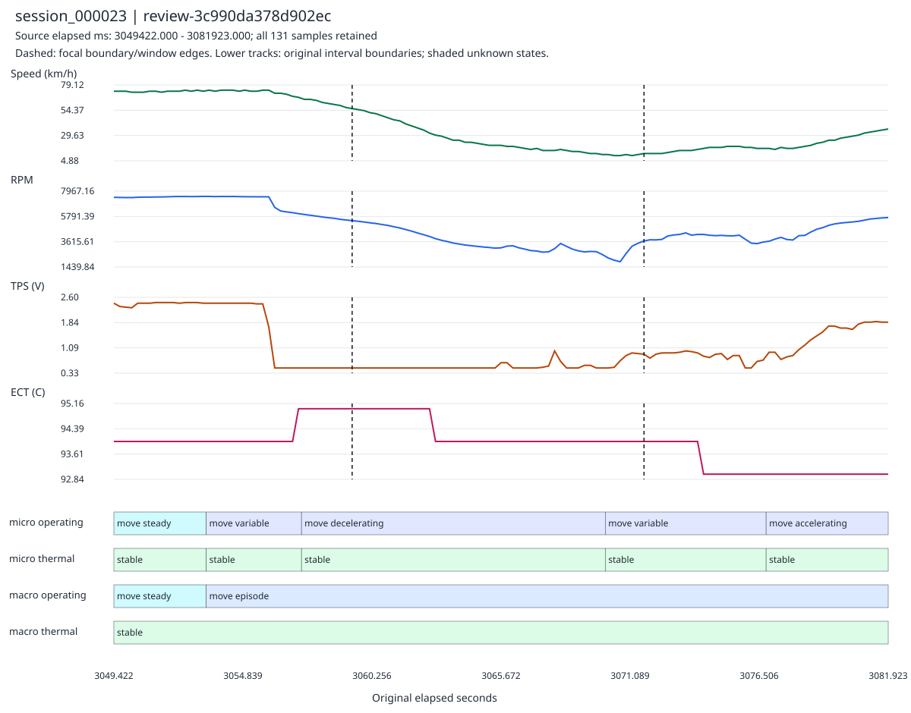

| Track | Label | Original Interval s | Interval ID |
| --- | --- | --- | --- |
| micro_operating | moving_steady | 3044.5470-3053.2965 | `auto_suggest_ad68d2135f0f3694fca5` |
| micro_operating | moving_variable | 3053.2965-3057.2965 | `auto_suggest_cf85d65c16a946506a55` |
| micro_operating | moving_decelerating | 3057.2965-3070.0465 | `auto_suggest_a4809087fc25f2c3402f` |
| micro_operating | moving_variable | 3070.0465-3076.7970 | `auto_suggest_ddc4e94909c5d141d025` |
| micro_operating | moving_accelerating | 3076.7970-3093.2970 | `auto_suggest_4c206a68922fde73d216` |
| micro_thermal | stable | 3044.5470-3053.2965 | `auto_suggest_ad68d2135f0f3694fca5` |
| micro_thermal | stable | 3053.2965-3057.2965 | `auto_suggest_cf85d65c16a946506a55` |
| micro_thermal | stable | 3057.2965-3070.0465 | `auto_suggest_a4809087fc25f2c3402f` |
| micro_thermal | stable | 3070.0465-3076.7970 | `auto_suggest_ddc4e94909c5d141d025` |
| micro_thermal | stable | 3076.7970-3093.2970 | `auto_suggest_4c206a68922fde73d216` |
| macro_operating | moving_steady | 3044.5470-3053.2965 | `macro-2b3ff8373779fa2795fd568e` |
| macro_operating | moving_episode | 3053.2965-3097.2970 | `macro-e4365189c0cf4cfc70ba0c9f` |
| macro_thermal | stable | 3021.5475-3301.7970 | `macro-25bee3a127d9eb1a42be1e62` |

Action: **pending**. Human review seconds: **not recorded**.

## 24: session_000005 / review-827a22e605f331bc

Source SHA-256: `260b706c68fc4807cf23ddb8977059ca3523d77c105d7f27093354b9d7072be4`

Evidence: 1250498.000-1282999.000 ms; indices 5000-5130 inclusive.
Focus: 1260.4990-1272.7490 s. Selection: Seeded random window for operating context coverage: moving_episode.

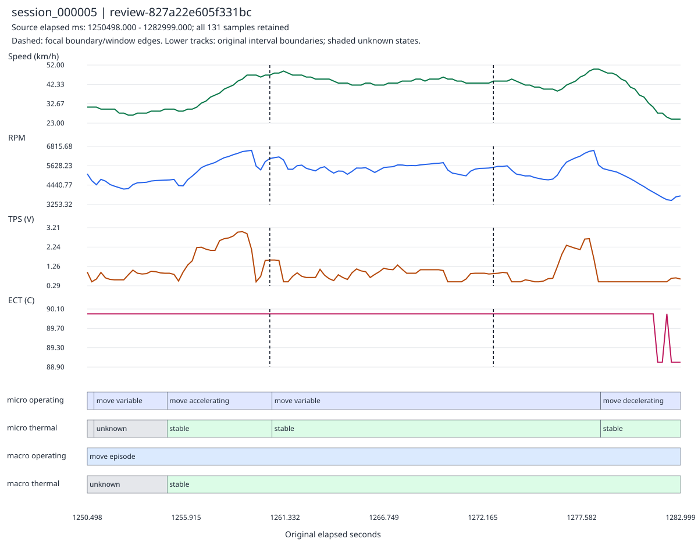

| Track | Label | Original Interval s | Interval ID |
| --- | --- | --- | --- |
| micro_operating | moving_accelerating | 1245.6235-1250.8735 | `auto_suggest_e9b125eb35e58dd432f7` |
| micro_operating | moving_variable | 1250.8735-1254.8735 | `auto_suggest_f3b3eb973fcb4b4b33bc` |
| micro_operating | moving_accelerating | 1254.8735-1260.6240 | `auto_suggest_e431a7cde8f1c8b66735` |
| micro_operating | moving_variable | 1260.6240-1278.6245 | `auto_suggest_b197cc7bea7e84aa9334` |
| micro_operating | moving_decelerating | 1278.6245-1289.6240 | `auto_suggest_e39c708aba36e3972886` |
| micro_thermal | unknown | 1245.6235-1250.8735 | `auto_suggest_e9b125eb35e58dd432f7` |
| micro_thermal | unknown | 1250.8735-1254.8735 | `auto_suggest_f3b3eb973fcb4b4b33bc` |
| micro_thermal | stable | 1254.8735-1260.6240 | `auto_suggest_e431a7cde8f1c8b66735` |
| micro_thermal | stable | 1260.6240-1278.6245 | `auto_suggest_b197cc7bea7e84aa9334` |
| micro_thermal | stable | 1278.6245-1289.6240 | `auto_suggest_e39c708aba36e3972886` |
| macro_operating | moving_episode | 1225.6240-1367.1245 | `macro-d472730f4c99277144539d36` |
| macro_thermal | unknown | 1191.8735-1254.8735 | `macro-aead7459d7410fcbf1509933` |
| macro_thermal | stable | 1254.8735-1963.9970 | `macro-9fbf89cab4a2253770b494b8` |

Action: **pending**. Human review seconds: **not recorded**.

## 25: session_000004 / review-2472f2fbdb60230a

Source SHA-256: `8fe7ee4652a9154007eed9d04d199911c909d13327b0f5bf90c7f3bddb34a0d7`

Evidence: 252500.000-285001.000 ms; indices 1009-1139 inclusive.
Focus: 262.7500-275.0000 s. Selection: Seeded random window for operating context coverage: moving_episode.

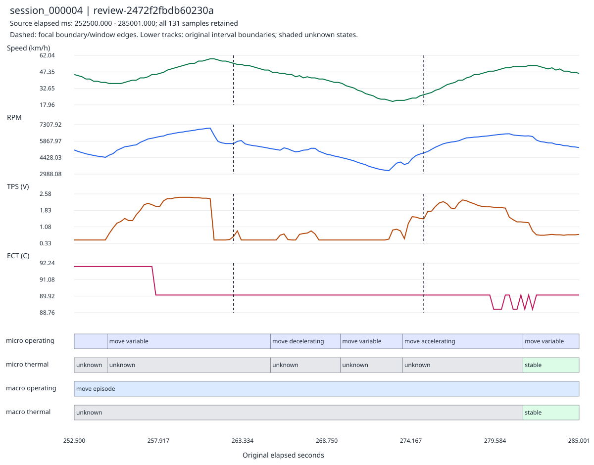

| Track | Label | Original Interval s | Interval ID |
| --- | --- | --- | --- |
| micro_operating | moving_decelerating | 250.3760-254.6265 | `auto_suggest_18cceccd75f777e48c46` |
| micro_operating | moving_variable | 254.6265-265.1250 | `auto_suggest_d76d133e144d51471e02` |
| micro_operating | moving_decelerating | 265.1250-269.6250 | `auto_suggest_abe3615a14287eff331b` |
| micro_operating | moving_variable | 269.6250-273.6250 | `auto_suggest_25d9457451f3937fee4a` |
| micro_operating | moving_accelerating | 273.6250-281.3760 | `auto_suggest_32f652f8df4aa6637de5` |
| micro_operating | moving_variable | 281.3760-285.3760 | `auto_suggest_08057a882eee30058283` |
| micro_thermal | unknown | 250.3760-254.6265 | `auto_suggest_18cceccd75f777e48c46` |
| micro_thermal | unknown | 254.6265-265.1250 | `auto_suggest_d76d133e144d51471e02` |
| micro_thermal | unknown | 265.1250-269.6250 | `auto_suggest_abe3615a14287eff331b` |
| micro_thermal | unknown | 269.6250-273.6250 | `auto_suggest_25d9457451f3937fee4a` |
| micro_thermal | unknown | 273.6250-281.3760 | `auto_suggest_32f652f8df4aa6637de5` |
| micro_thermal | stable | 281.3760-285.3760 | `auto_suggest_08057a882eee30058283` |
| macro_operating | moving_episode | 228.6260-309.3745 | `macro-dd50c329aa409039977d5e0c` |
| macro_thermal | unknown | 101.6265-281.3760 | `macro-1b7e4d1b91b9421ef4521cf6` |
| macro_thermal | stable | 281.3760-369.1255 | `macro-c258e33eb30ebc33f0a2fb74` |

Action: **pending**. Human review seconds: **not recorded**.

## 26: session_000007 / review-4fe8dcd97ccf7c0f

Source SHA-256: `509cc87f61d71f39f7ca4f0651424d1ba73dc15b97f49325b7586dcbbec77879`

Evidence: 140251.000-160500.000 ms; indices 561-642 inclusive.
Focus: 150.3755-150.3755 s. Selection: Seeded random boundary for operating context coverage.

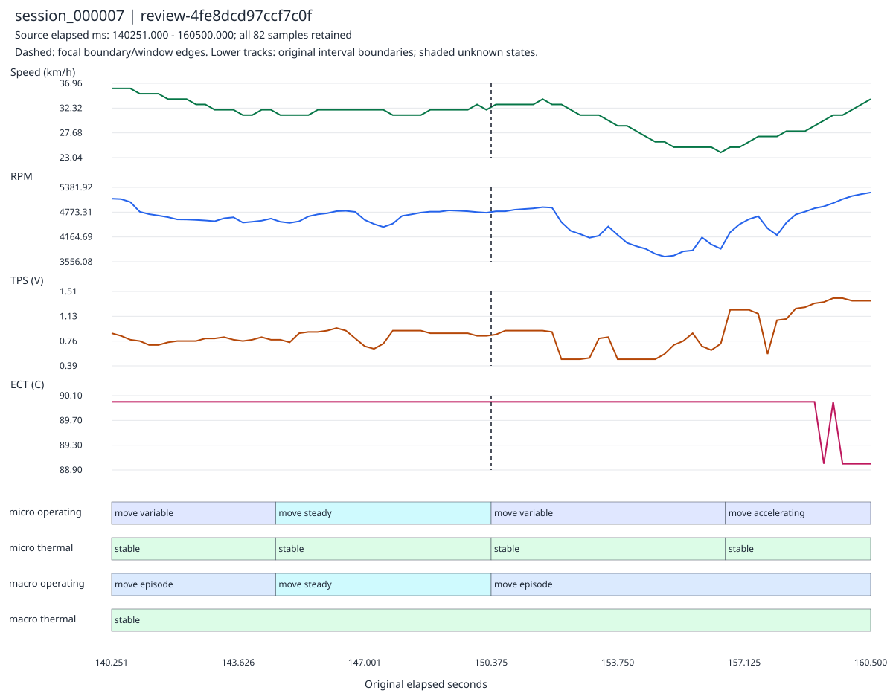

| Track | Label | Original Interval s | Interval ID |
| --- | --- | --- | --- |
| micro_operating | moving_variable | 139.3760-144.6260 | `auto_suggest_d71b45b0c8b36dc8af69` |
| micro_operating | moving_steady | 144.6260-150.3755 | `auto_suggest_9dbbefc94009f3b8e462` |
| micro_operating | moving_variable | 150.3755-156.6260 | `auto_suggest_41556c3f033a79ab7b70` |
| micro_operating | moving_accelerating | 156.6260-164.1260 | `auto_suggest_2c1ef85ae128a45e6cbe` |
| micro_thermal | stable | 139.3760-144.6260 | `auto_suggest_d71b45b0c8b36dc8af69` |
| micro_thermal | stable | 144.6260-150.3755 | `auto_suggest_9dbbefc94009f3b8e462` |
| micro_thermal | stable | 150.3755-156.6260 | `auto_suggest_41556c3f033a79ab7b70` |
| micro_thermal | stable | 156.6260-164.1260 | `auto_suggest_2c1ef85ae128a45e6cbe` |
| macro_operating | moving_episode | 139.3760-144.6260 | `macro-393b0c5aaf02a94c64e96233` |
| macro_operating | moving_steady | 144.6260-150.3755 | `macro-18ddf9e7bd3c3bd9435015dd` |
| macro_operating | moving_episode | 150.3755-174.3755 | `macro-5b673c8a83ab4bde7eb3c943` |
| macro_thermal | stable | 0.0000-784.3755 | `macro-4695f405d86378e2400db249` |

Action: **pending**. Human review seconds: **not recorded**.

## 27: session_000023 / review-cac81d7fdc8c1b9d

Source SHA-256: `f034aa1aba5d36cca1f4e99c43b94e5cb298181e86dd74125c8f10d45d883e5a`

Evidence: 1272673.000-1305421.000 ms; indices 5089-5220 inclusive.
Focus: 1282.9210-1295.1730 s. Selection: Seeded random window for thermal context coverage: warming.

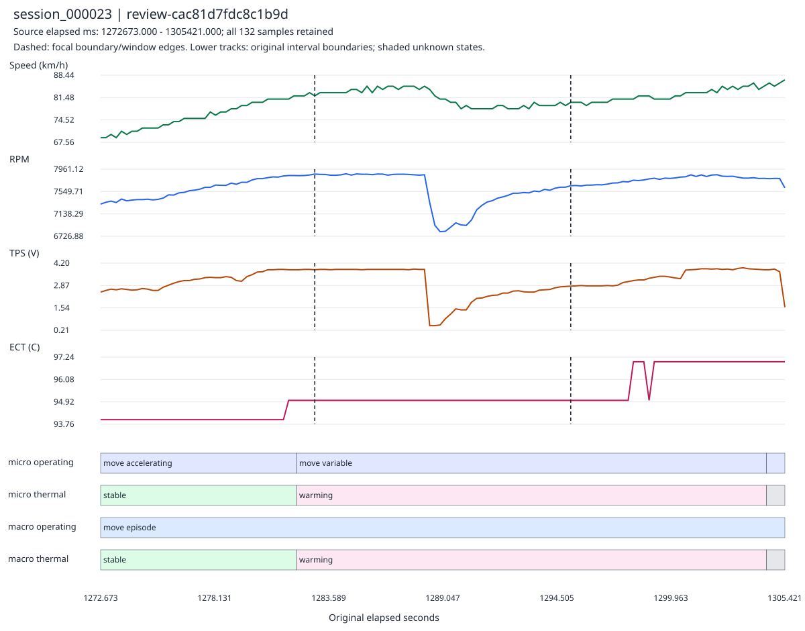

| Track | Label | Original Interval s | Interval ID |
| --- | --- | --- | --- |
| micro_operating | moving_accelerating | 1270.7965-1282.0470 | `auto_suggest_7441a02d65db3b23d3d0` |
| micro_operating | moving_variable | 1282.0470-1304.5470 | `auto_suggest_262d83a1760b762dcd24` |
| micro_operating | moving_decelerating | 1304.5470-1308.7970 | `auto_suggest_2d14c83b52f0e2e5ce10` |
| micro_thermal | stable | 1270.7965-1282.0470 | `auto_suggest_7441a02d65db3b23d3d0` |
| micro_thermal | warming | 1282.0470-1304.5470 | `auto_suggest_262d83a1760b762dcd24` |
| micro_thermal | unknown | 1304.5470-1308.7970 | `auto_suggest_2d14c83b52f0e2e5ce10` |
| macro_operating | moving_episode | 1255.2965-1329.2960 | `macro-ee1877930cd8e2a6502b5922` |
| macro_thermal | stable | 1174.2960-1282.0470 | `macro-c6bb7513a1db672fe475cf7d` |
| macro_thermal | warming | 1282.0470-1304.5470 | `macro-fd8189e7327a795f816f9f9a` |
| macro_thermal | unknown | 1304.5470-1372.2975 | `macro-77c69ce25b199cb18747153c` |

Action: **pending**. Human review seconds: **not recorded**.

## 28: session_000018 / review-1944e3749a6a4ab7

Source SHA-256: `6ef183818d3743c5bae2527928487f7f5991264f2f07528b965bddd0979e4b04`

Evidence: 683750.000-703999.000 ms; indices 2733-2814 inclusive.
Focus: 693.8760-693.8760 s. Selection: Seeded random boundary for operating context coverage.

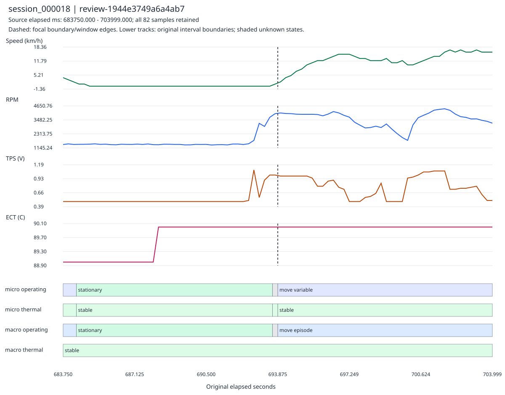

| Track | Label | Original Interval s | Interval ID |
| --- | --- | --- | --- |
| micro_operating | moving_decelerating | 676.1250-684.3760 | `auto_suggest_185e14ce7335d4aceacf` |
| micro_operating | stationary_running | 684.3760-693.6250 | `auto_suggest_57c92e6f4c581a29b896` |
| micro_operating | unknown | 693.6250-693.8760 | `auto_suggest_d741abf13eacfd9a27f0` |
| micro_operating | moving_variable | 693.8760-704.8755 | `auto_suggest_56af747b6acefd3c56f1` |
| micro_thermal | stable | 676.1250-684.3760 | `auto_suggest_185e14ce7335d4aceacf` |
| micro_thermal | stable | 684.3760-693.6250 | `auto_suggest_57c92e6f4c581a29b896` |
| micro_thermal | stable | 693.6250-693.8760 | `auto_suggest_d741abf13eacfd9a27f0` |
| micro_thermal | stable | 693.8760-704.8755 | `auto_suggest_56af747b6acefd3c56f1` |
| macro_operating | moving_episode | 640.6250-684.3760 | `macro-38a40d3c4adeb61a6e458bee` |
| macro_operating | stationary_running | 684.3760-693.6250 | `macro-72e2ccdf2ecb2fb92edd20f0` |
| macro_operating | unknown | 693.6250-693.8760 | `macro-52ed4b2df1efae9bc134a090` |
| macro_operating | moving_episode | 693.8760-809.3760 | `macro-c3c0b0c2473efa2155e7f8fc` |
| macro_thermal | stable | 459.8765-3115.1265 | `macro-57ee376e41c62c8897b5a654` |

Action: **pending**. Human review seconds: **not recorded**.

## 29: session_000006 / review-5bd28cd5324bd1f9

Source SHA-256: `61d64e80833db597b4e10725bbc12dc6eb844157e6fc3db52ceaaeb33b45ffb9`

Evidence: 65001.000-97748.000 ms; indices 260-390 inclusive.
Focus: 75.2480-87.5000 s. Selection: Seeded random window for operating context coverage: moving_episode.

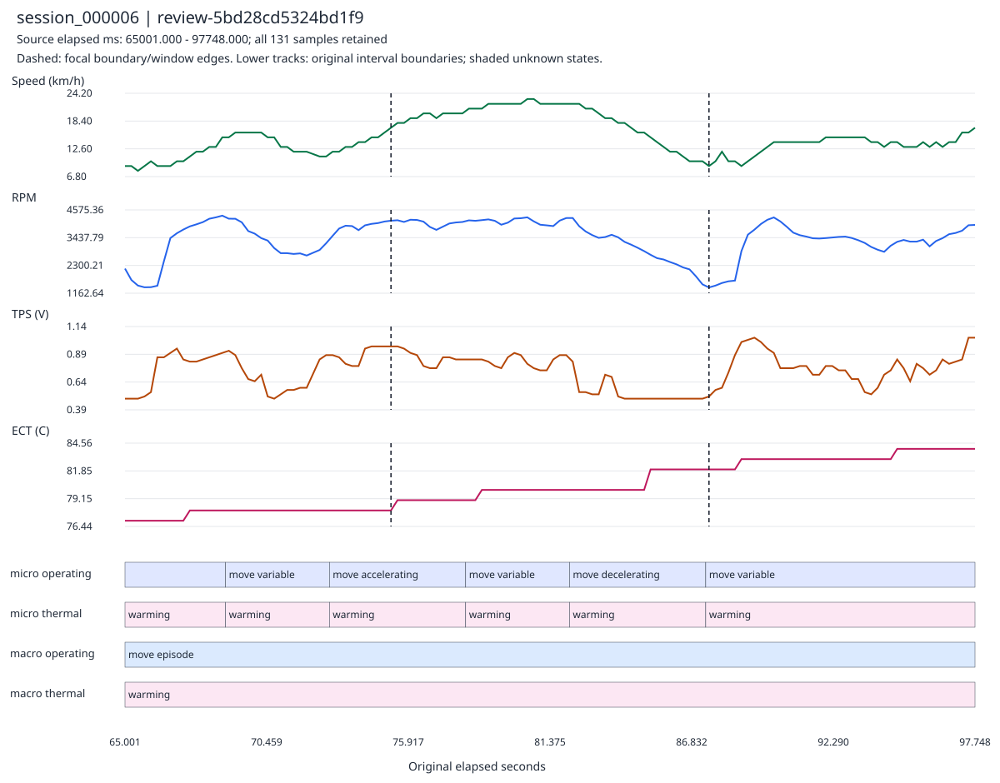

| Track | Label | Original Interval s | Interval ID |
| --- | --- | --- | --- |
| micro_operating | moving_accelerating | 62.8740-68.8750 | `auto_suggest_227a7194e93158587f6b` |
| micro_operating | moving_variable | 68.8750-72.8750 | `auto_suggest_298f729ba6665e5fb0cf` |
| micro_operating | moving_accelerating | 72.8750-78.1255 | `auto_suggest_dcaafe00618a6371486d` |
| micro_operating | moving_variable | 78.1255-82.1255 | `auto_suggest_4b481d358325e58c986b` |
| micro_operating | moving_decelerating | 82.1255-87.3745 | `auto_suggest_7850418a3cca02a002f3` |
| micro_operating | moving_variable | 87.3745-108.1250 | `auto_suggest_b6e4cc8fe93ac7b9a3f3` |
| micro_thermal | warming | 62.8740-68.8750 | `auto_suggest_227a7194e93158587f6b` |
| micro_thermal | warming | 68.8750-72.8750 | `auto_suggest_298f729ba6665e5fb0cf` |
| micro_thermal | warming | 72.8750-78.1255 | `auto_suggest_dcaafe00618a6371486d` |
| micro_thermal | warming | 78.1255-82.1255 | `auto_suggest_4b481d358325e58c986b` |
| micro_thermal | warming | 82.1255-87.3745 | `auto_suggest_7850418a3cca02a002f3` |
| micro_thermal | warming | 87.3745-108.1250 | `auto_suggest_b6e4cc8fe93ac7b9a3f3` |
| macro_operating | moving_episode | 53.6245-127.3745 | `macro-3fa0a2d730a9a4097c1a2db6` |
| macro_thermal | warming | 0.0000-127.6255 | `macro-269dd46d9f561e435d5b831c` |

Action: **pending**. Human review seconds: **not recorded**.

## 30: session_000014 / review-e8c496f27edf8394

Source SHA-256: `88245a15180859689db636159008582db646071e03c9d4eacb69476a7e95d8d6`

Evidence: 169999.000-202251.000 ms; indices 680-809 inclusive.
Focus: 180.0010-192.2500 s. Selection: Seeded random window for operating context coverage: stationary_running.

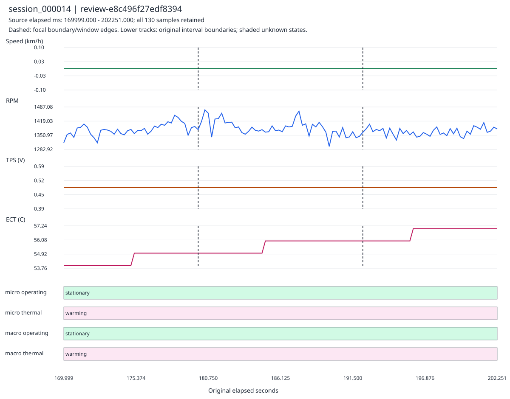

| Track | Label | Original Interval s | Interval ID |
| --- | --- | --- | --- |
| micro_operating | stationary_running | 0.0000-227.6250 | `auto_suggest_7cd371104465585120a4` |
| micro_thermal | warming | 0.0000-227.6250 | `auto_suggest_7cd371104465585120a4` |
| macro_operating | stationary_running | 0.0000-297.8760 | `macro-1fcb6bc0ed2fd1af60691421` |
| macro_thermal | warming | 0.0000-227.6250 | `macro-d58c92d2dcce8a9bea57e52e` |

Action: **pending**. Human review seconds: **not recorded**.

## 31: session_000018 / review-4b2cf56307579505

Source SHA-256: `6ef183818d3743c5bae2527928487f7f5991264f2f07528b965bddd0979e4b04`

Evidence: 3669502.000-3702250.000 ms; indices 14669-14800 inclusive.
Focus: 3679.7500-3692.0020 s. Selection: Seeded random window for operating context coverage: moving_steady.

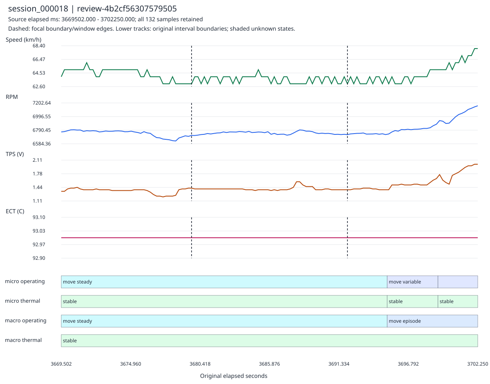

| Track | Label | Original Interval s | Interval ID |
| --- | --- | --- | --- |
| micro_operating | moving_steady | 3651.1265-3695.1265 | `auto_suggest_888affb91e218fe03491` |
| micro_operating | moving_variable | 3695.1265-3699.1265 | `auto_suggest_690ac7d19ee53248e455` |
| micro_operating | moving_accelerating | 3699.1265-3703.3755 | `auto_suggest_08e7da83bf081be078b1` |
| micro_thermal | stable | 3651.1265-3695.1265 | `auto_suggest_888affb91e218fe03491` |
| micro_thermal | stable | 3695.1265-3699.1265 | `auto_suggest_690ac7d19ee53248e455` |
| micro_thermal | stable | 3699.1265-3703.3755 | `auto_suggest_08e7da83bf081be078b1` |
| macro_operating | moving_steady | 3651.1265-3695.1265 | `macro-d98c201e1972677b73977265` |
| macro_operating | moving_episode | 3695.1265-3715.3760 | `macro-9a5561b5229bfbfa4baa5e69` |
| macro_thermal | stable | 3491.6250-4447.1250 | `macro-ef4f7d3ef8f9ede05d0b7918` |

Action: **pending**. Human review seconds: **not recorded**.

## 32: session_000001 / review-d2df057b441e7945

Source SHA-256: `5af43708ba2f707e5d8c46b7d61ee86d3a2e62a0698427fd771114156933d017`

Evidence: 0.000-28999.000 ms; indices 0-116 inclusive.
Focus: 0.0000-28.9990 s. Selection: Full short capture: inspect measured speed/context consistency.

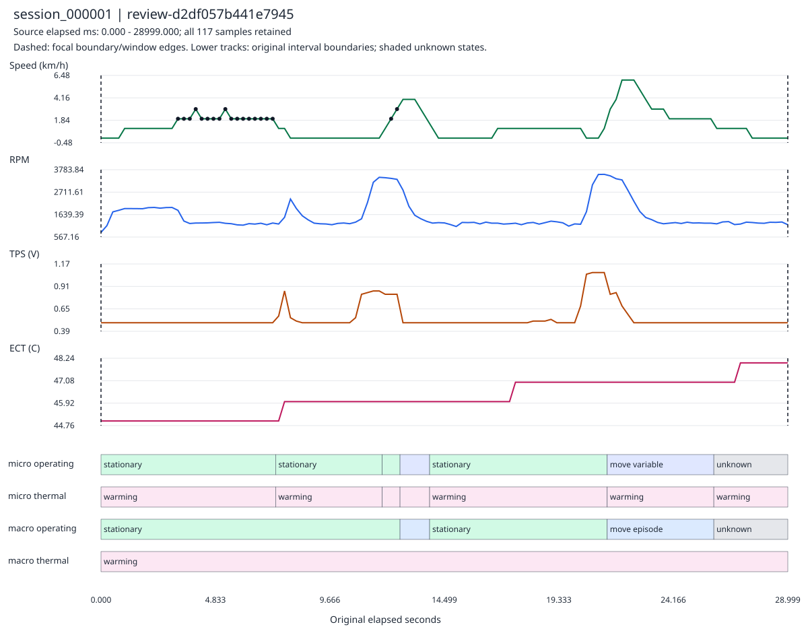

| Track | Label | Original Interval s | Interval ID |
| --- | --- | --- | --- |
| micro_operating | stationary_running | 0.0000-7.3750 | `auto_suggest_837689bf6fbfc321032b` |
| micro_operating | stationary_running | 7.3750-11.8745 | `auto_suggest_52e02aa9277be2fa35bb` |
| micro_operating | stationary_running | 11.8745-12.6250 | `auto_suggest_bb333d5833164f1c4c5a` |
| micro_operating | moving_variable | 12.6250-13.8750 | `auto_suggest_fa20bca7d21dfbe004ea` |
| micro_operating | stationary_running | 13.8750-21.3750 | `auto_suggest_d1c79b952e4be36025f9` |
| micro_operating | moving_variable | 21.3750-25.8745 | `auto_suggest_3a67d341d135d8065a12` |
| micro_operating | unknown | 25.8745-28.9990 | `auto_suggest_1aca06a1c2404fd0508b` |
| micro_thermal | warming | 0.0000-7.3750 | `auto_suggest_837689bf6fbfc321032b` |
| micro_thermal | warming | 7.3750-11.8745 | `auto_suggest_52e02aa9277be2fa35bb` |
| micro_thermal | warming | 11.8745-12.6250 | `auto_suggest_bb333d5833164f1c4c5a` |
| micro_thermal | warming | 12.6250-13.8750 | `auto_suggest_fa20bca7d21dfbe004ea` |
| micro_thermal | warming | 13.8750-21.3750 | `auto_suggest_d1c79b952e4be36025f9` |
| micro_thermal | warming | 21.3750-25.8745 | `auto_suggest_3a67d341d135d8065a12` |
| micro_thermal | warming | 25.8745-28.9990 | `auto_suggest_1aca06a1c2404fd0508b` |
| macro_operating | stationary_running | 0.0000-12.6250 | `macro-4364bf33d6ffe28671a8a2b4` |
| macro_operating | moving_episode | 12.6250-13.8750 | `macro-57baf9c1ff31ca1b710a7527` |
| macro_operating | stationary_running | 13.8750-21.3750 | `macro-88e3764aa1bbb943a0c267c8` |
| macro_operating | moving_episode | 21.3750-25.8745 | `macro-4b46407ed5667e565c6ad8a6` |
| macro_operating | unknown | 25.8745-28.9990 | `macro-dbdb6615f7a87487a2ca48b4` |
| macro_thermal | warming | 0.0000-28.9990 | `macro-cf345bba82e9f7535bb8b9a5` |

Action: **pending**. Human review seconds: **not recorded**.

## 33: session_000023 / review-30c11f6815894889

Source SHA-256: `f034aa1aba5d36cca1f4e99c43b94e5cb298181e86dd74125c8f10d45d883e5a`

Evidence: 1506672.000-1526923.000 ms; indices 6025-6106 inclusive.
Focus: 1516.7970-1516.7970 s. Selection: Seeded random boundary for thermal context coverage.

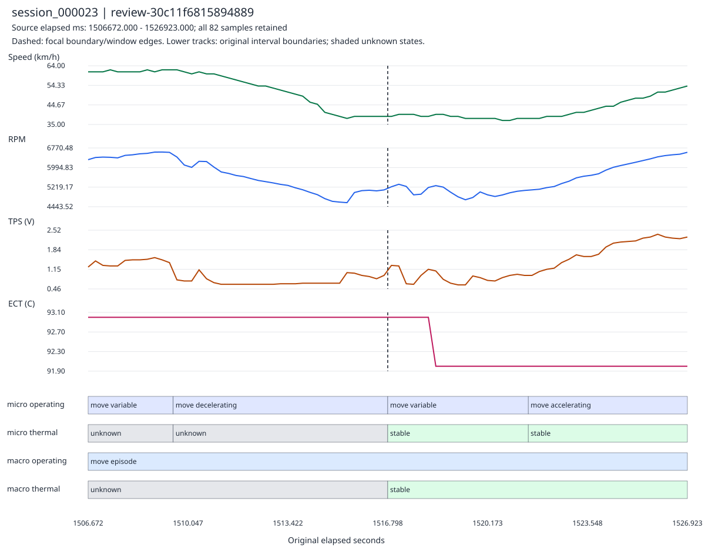

| Track | Label | Original Interval s | Interval ID |
| --- | --- | --- | --- |
| micro_operating | moving_variable | 1505.2970-1509.5470 | `auto_suggest_1ae9f8e9b44882da0ddd` |
| micro_operating | moving_decelerating | 1509.5470-1516.7970 | `auto_suggest_8556ca90780f882b8347` |
| micro_operating | moving_variable | 1516.7970-1521.5455 | `auto_suggest_92bf21e2a87b1a90d894` |
| micro_operating | moving_accelerating | 1521.5455-1531.2965 | `auto_suggest_4a6f5ae5d22947503f92` |
| micro_thermal | unknown | 1505.2970-1509.5470 | `auto_suggest_1ae9f8e9b44882da0ddd` |
| micro_thermal | unknown | 1509.5470-1516.7970 | `auto_suggest_8556ca90780f882b8347` |
| micro_thermal | stable | 1516.7970-1521.5455 | `auto_suggest_92bf21e2a87b1a90d894` |
| micro_thermal | stable | 1521.5455-1531.2965 | `auto_suggest_4a6f5ae5d22947503f92` |
| macro_operating | moving_episode | 1397.7965-1537.2970 | `macro-4d3b6bc6da4dad306d4d7070` |
| macro_thermal | unknown | 1500.0465-1516.7970 | `macro-c99a877e1174cc090078327a` |
| macro_thermal | stable | 1516.7970-1555.5475 | `macro-033990a45d5dcbc9b8c2c9b4` |

Action: **pending**. Human review seconds: **not recorded**.

## 34: session_000018 / review-b259ed0b4509be3b

Source SHA-256: `6ef183818d3743c5bae2527928487f7f5991264f2f07528b965bddd0979e4b04`

Evidence: 3360251.000-3380501.000 ms; indices 13434-13515 inclusive.
Focus: 3370.3760-3370.3760 s. Selection: Seeded random boundary for thermal context coverage.

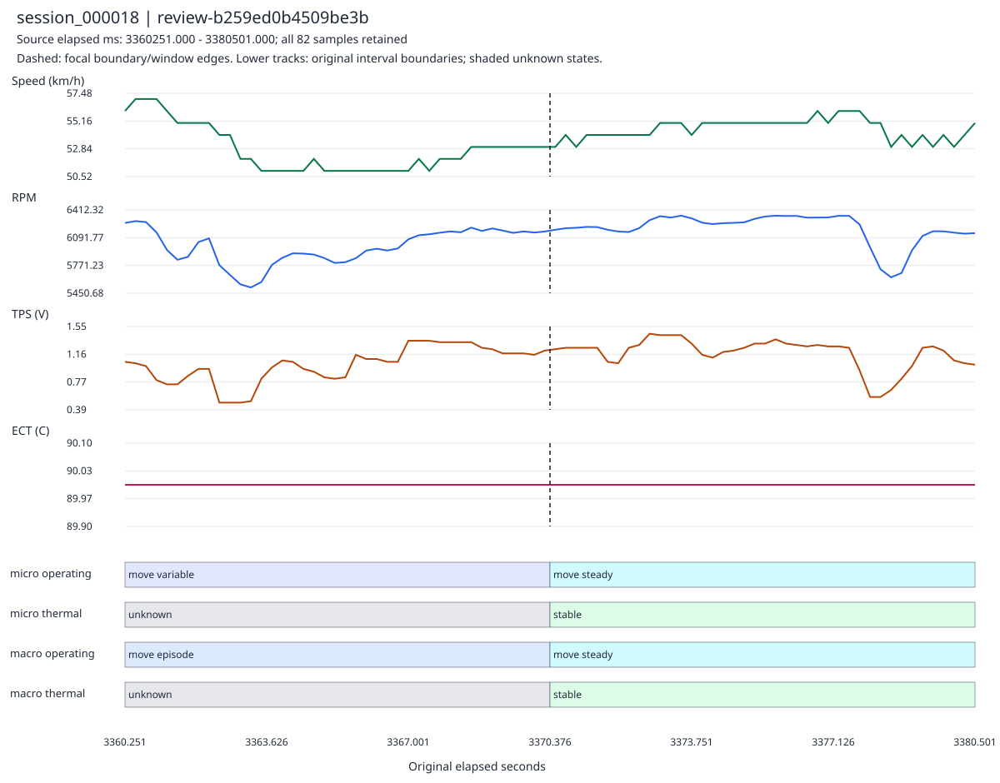

| Track | Label | Original Interval s | Interval ID |
| --- | --- | --- | --- |
| micro_operating | moving_variable | 3359.3765-3370.3760 | `auto_suggest_d093bcfa5951f471974e` |
| micro_operating | moving_steady | 3370.3760-3384.1265 | `auto_suggest_69805abf056f4f32aeff` |
| micro_thermal | unknown | 3359.3765-3370.3760 | `auto_suggest_d093bcfa5951f471974e` |
| micro_thermal | stable | 3370.3760-3384.1265 | `auto_suggest_69805abf056f4f32aeff` |
| macro_operating | moving_episode | 3359.3765-3370.3760 | `macro-15fc2e5b206c3028e13279bf` |
| macro_operating | moving_steady | 3370.3760-3384.1265 | `macro-7888c641da60f783d39d23e2` |
| macro_thermal | unknown | 3325.8760-3370.3760 | `macro-18cf7cd07b78a5be00b35339` |
| macro_thermal | stable | 3370.3760-3451.8765 | `macro-0a7be5ceb11698f4af9ac088` |

Action: **pending**. Human review seconds: **not recorded**.

## 35: session_000005 / review-447b5b655f8dfc97

Source SHA-256: `260b706c68fc4807cf23ddb8977059ca3523d77c105d7f27093354b9d7072be4`

Evidence: 1703999.000-1724248.000 ms; indices 6812-6893 inclusive.
Focus: 1714.1245-1714.1245 s. Selection: Seeded random boundary for operating context coverage.

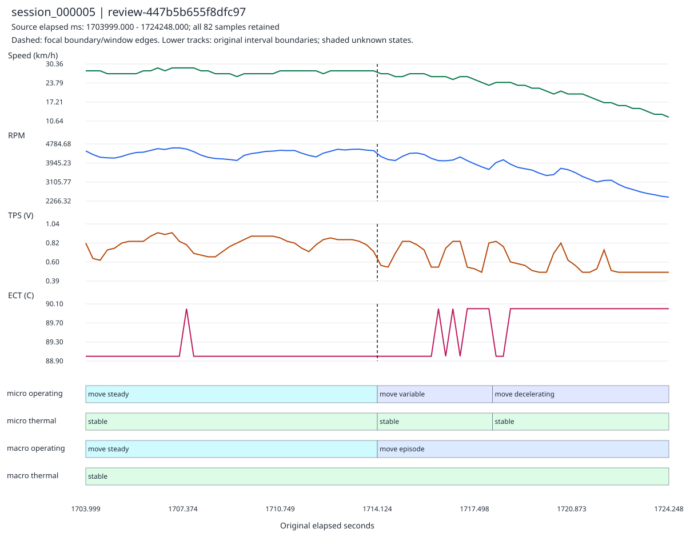

| Track | Label | Original Interval s | Interval ID |
| --- | --- | --- | --- |
| micro_operating | moving_steady | 1703.8740-1714.1245 | `auto_suggest_3e91958b3b4651fe6922` |
| micro_operating | moving_variable | 1714.1245-1718.1245 | `auto_suggest_e1576db9a004744e0ca4` |
| micro_operating | moving_decelerating | 1718.1245-1725.8730 | `auto_suggest_481a8cefc26316936d24` |
| micro_thermal | stable | 1703.8740-1714.1245 | `auto_suggest_3e91958b3b4651fe6922` |
| micro_thermal | stable | 1714.1245-1718.1245 | `auto_suggest_e1576db9a004744e0ca4` |
| micro_thermal | stable | 1718.1245-1725.8730 | `auto_suggest_481a8cefc26316936d24` |
| macro_operating | moving_steady | 1703.8740-1714.1245 | `macro-c1946c4f43bf7abafd890ed8` |
| macro_operating | moving_episode | 1714.1245-1839.6230 | `macro-1a8a8e75ee7a03249dc4c953` |
| macro_thermal | stable | 1254.8735-1963.9970 | `macro-9fbf89cab4a2253770b494b8` |

Action: **pending**. Human review seconds: **not recorded**.

## 36: session_000002 / review-87666c3c24075d4d

Source SHA-256: `19071f9dac5a874ca4245233a3bb94770dc34d8db10a1dfa54fbf6cdb29c5eaa`

Evidence: 1418252.000-1438501.000 ms; indices 5667-5748 inclusive.
Focus: 1428.3760-1428.3760 s. Selection: Seeded random boundary for thermal context coverage.

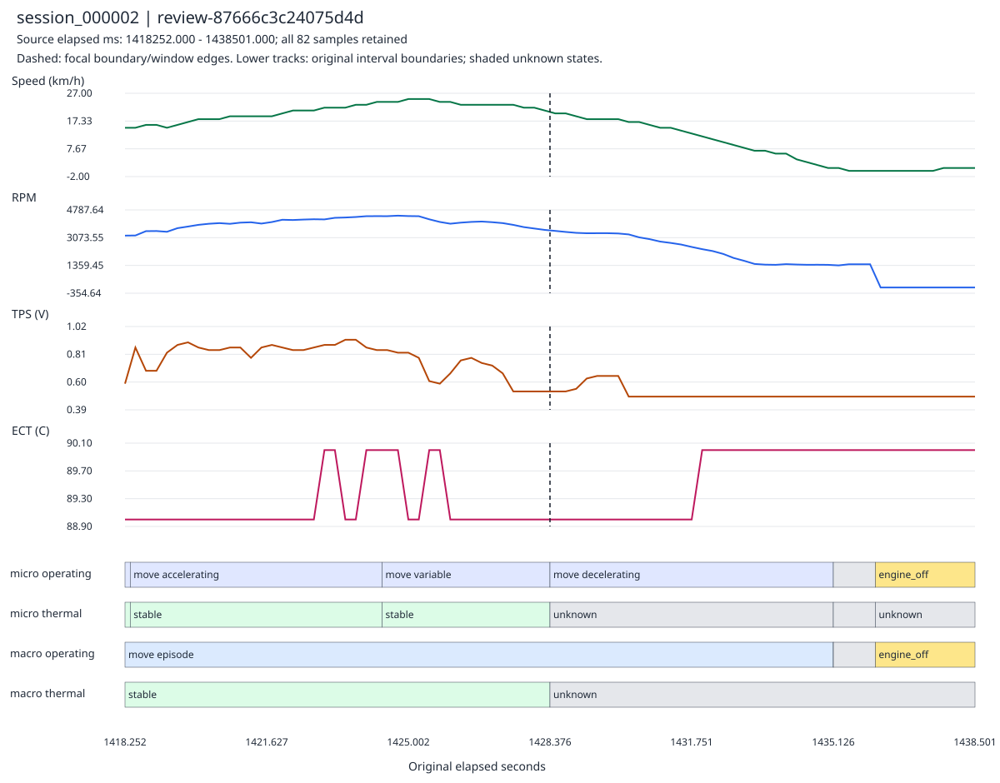

| Track | Label | Original Interval s | Interval ID |
| --- | --- | --- | --- |
| micro_operating | moving_variable | 1414.3760-1418.3760 | `auto_suggest_faaaf76c62d9cd134b1c` |
| micro_operating | moving_accelerating | 1418.3760-1424.3760 | `auto_suggest_0de08fd7ddb1a71aaf51` |
| micro_operating | moving_variable | 1424.3760-1428.3760 | `auto_suggest_cb4fead50afe891b3bd3` |
| micro_operating | moving_decelerating | 1428.3760-1435.1260 | `auto_suggest_d02434c633863e72430f` |
| micro_operating | unknown | 1435.1260-1436.1270 | `auto_suggest_a4f8640937f94eda8008` |
| micro_operating | engine_off | 1436.1270-1446.5030 | `auto_suggest_62310e2fed063491239d` |
| micro_thermal | stable | 1414.3760-1418.3760 | `auto_suggest_faaaf76c62d9cd134b1c` |
| micro_thermal | stable | 1418.3760-1424.3760 | `auto_suggest_0de08fd7ddb1a71aaf51` |
| micro_thermal | stable | 1424.3760-1428.3760 | `auto_suggest_cb4fead50afe891b3bd3` |
| micro_thermal | unknown | 1428.3760-1435.1260 | `auto_suggest_d02434c633863e72430f` |
| micro_thermal | unknown | 1435.1260-1436.1270 | `auto_suggest_a4f8640937f94eda8008` |
| micro_thermal | unknown | 1436.1270-1446.5030 | `auto_suggest_62310e2fed063491239d` |
| macro_operating | moving_episode | 1294.3760-1435.1260 | `macro-0619e1758df4b3c6dfba199e` |
| macro_operating | unknown | 1435.1260-1435.1270 | `macro-46c2a1bb673c74af4c929766` |
| macro_operating | unknown | 1435.1270-1436.1270 | `macro-c4f8a561b99ecf59102b1592` |
| macro_operating | engine_off | 1436.1270-1446.5030 | `macro-f8df332eef18dcf147a96397` |
| macro_thermal | stable | 1219.1260-1428.3760 | `macro-3d8bb9dbfe95e965bba5aa01` |
| macro_thermal | unknown | 1428.3760-1446.5030 | `macro-11c568085688135fb63fc295` |

Action: **pending**. Human review seconds: **not recorded**.

## 37: session_000004 / review-26255331dc21df3e

Source SHA-256: `8fe7ee4652a9154007eed9d04d199911c909d13327b0f5bf90c7f3bddb34a0d7`

Evidence: 208001.000-228250.000 ms; indices 831-912 inclusive.
Focus: 218.1260-218.1260 s. Selection: Seeded random boundary for operating context coverage: stationary_running.

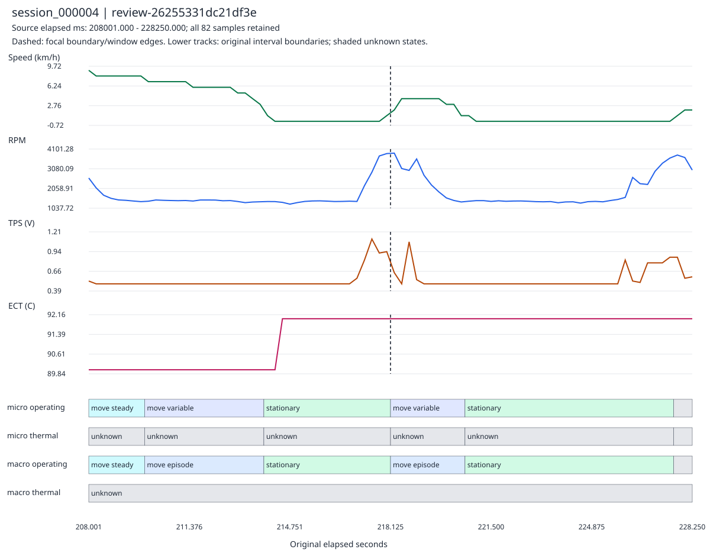

| Track | Label | Original Interval s | Interval ID |
| --- | --- | --- | --- |
| micro_operating | moving_steady | 201.3760-209.8750 | `auto_suggest_c95d272e7c62a2d2d04f` |
| micro_operating | moving_variable | 209.8750-213.8760 | `auto_suggest_119ce3a3e854dee148fa` |
| micro_operating | stationary_running | 213.8760-218.1260 | `auto_suggest_b00f864e021d7e8947fb` |
| micro_operating | moving_variable | 218.1260-220.6250 | `auto_suggest_c262ead15949c31aacf5` |
| micro_operating | stationary_running | 220.6250-227.6255 | `auto_suggest_0ac49f92398100b45bc0` |
| micro_operating | unknown | 227.6255-228.6260 | `auto_suggest_b8dfff1c52a924d1bf9d` |
| micro_thermal | unknown | 201.3760-209.8750 | `auto_suggest_c95d272e7c62a2d2d04f` |
| micro_thermal | unknown | 209.8750-213.8760 | `auto_suggest_119ce3a3e854dee148fa` |
| micro_thermal | unknown | 213.8760-218.1260 | `auto_suggest_b00f864e021d7e8947fb` |
| micro_thermal | unknown | 218.1260-220.6250 | `auto_suggest_c262ead15949c31aacf5` |
| micro_thermal | unknown | 220.6250-227.6255 | `auto_suggest_0ac49f92398100b45bc0` |
| micro_thermal | unknown | 227.6255-228.6260 | `auto_suggest_b8dfff1c52a924d1bf9d` |
| macro_operating | moving_steady | 201.3760-209.8750 | `macro-9acab3374cc73b54d33cdfb4` |
| macro_operating | moving_episode | 209.8750-213.8760 | `macro-f71d3422429a4304ffa273c1` |
| macro_operating | stationary_running | 213.8760-218.1260 | `macro-6fbfa1ba4a1b2c990c4605a6` |
| macro_operating | moving_episode | 218.1260-220.6250 | `macro-e7b48c00c9bb1a1f4449fbc1` |
| macro_operating | stationary_running | 220.6250-227.6255 | `macro-9ef3951bd2065764f751b2f7` |
| macro_operating | unknown | 227.6255-228.6260 | `macro-1ad4acee7058da87e386d1ac` |
| macro_thermal | unknown | 101.6265-281.3760 | `macro-1b7e4d1b91b9421ef4521cf6` |

Action: **pending**. Human review seconds: **not recorded**.

## 38: session_000002 / review-646f1f213cb1d1a0

Source SHA-256: `19071f9dac5a874ca4245233a3bb94770dc34d8db10a1dfa54fbf6cdb29c5eaa`

Evidence: 95001.000-127252.000 ms; indices 380-509 inclusive.
Focus: 105.0030-117.2520 s. Selection: Seeded random window for thermal context coverage: warming.

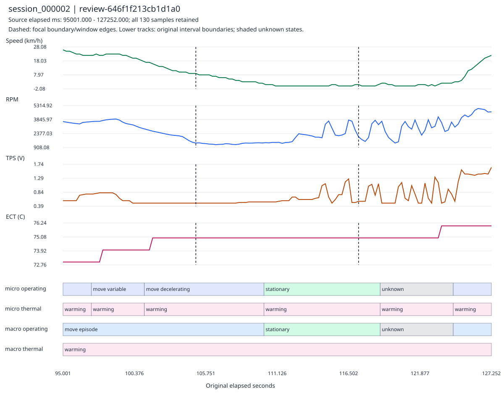

| Track | Label | Original Interval s | Interval ID |
| --- | --- | --- | --- |
| micro_operating | moving_decelerating | 89.8760-97.1265 | `auto_suggest_2b1ac33fc78611e9a991` |
| micro_operating | moving_variable | 97.1265-101.1265 | `auto_suggest_7824a8699af4b1d216d8` |
| micro_operating | moving_decelerating | 101.1265-110.1270 | `auto_suggest_9fa2406b9106e7644cc0` |
| micro_operating | stationary_running | 110.1270-118.8770 | `auto_suggest_9ffa4e64c4609d692777` |
| micro_operating | unknown | 118.8770-124.3770 | `auto_suggest_37223ec67f5a35a2c272` |
| micro_operating | moving_accelerating | 124.3770-131.3775 | `auto_suggest_c358295d0b9a23766b56` |
| micro_thermal | warming | 89.8760-97.1265 | `auto_suggest_2b1ac33fc78611e9a991` |
| micro_thermal | warming | 97.1265-101.1265 | `auto_suggest_7824a8699af4b1d216d8` |
| micro_thermal | warming | 101.1265-110.1270 | `auto_suggest_9fa2406b9106e7644cc0` |
| micro_thermal | warming | 110.1270-118.8770 | `auto_suggest_9ffa4e64c4609d692777` |
| micro_thermal | warming | 118.8770-124.3770 | `auto_suggest_37223ec67f5a35a2c272` |
| micro_thermal | warming | 124.3770-131.3775 | `auto_suggest_c358295d0b9a23766b56` |
| macro_operating | moving_episode | 18.6270-110.1270 | `macro-debf54a35d199820d96fa0e5` |
| macro_operating | stationary_running | 110.1270-118.8770 | `macro-445b6ea45ecae0a435bb0cf2` |
| macro_operating | unknown | 118.8770-124.3770 | `macro-e29f06110baabbfcd314ac5a` |
| macro_operating | moving_episode | 124.3770-381.6270 | `macro-6dc5937a7f316360caecf1e4` |
| macro_thermal | warming | 0.0000-180.6260 | `macro-278bd8202b03978ebd4f2fee` |

Action: **pending**. Human review seconds: **not recorded**.

## 39: session_000014 / review-420b1357a2620ee6

Source SHA-256: `88245a15180859689db636159008582db646071e03c9d4eacb69476a7e95d8d6`

Evidence: 0.000-32250.000 ms; indices 0-129 inclusive.
Focus: 10.0000-22.2500 s. Selection: Seeded random window for thermal context coverage: warming.

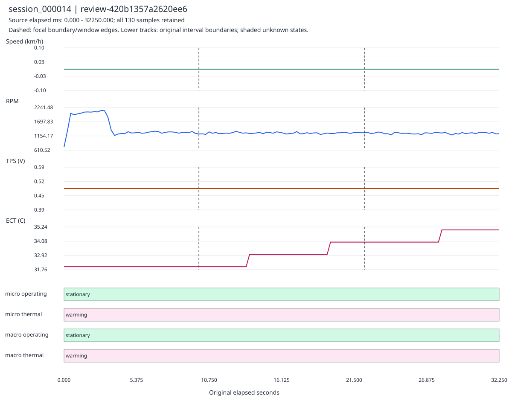

| Track | Label | Original Interval s | Interval ID |
| --- | --- | --- | --- |
| micro_operating | stationary_running | 0.0000-227.6250 | `auto_suggest_7cd371104465585120a4` |
| micro_thermal | warming | 0.0000-227.6250 | `auto_suggest_7cd371104465585120a4` |
| macro_operating | stationary_running | 0.0000-297.8760 | `macro-1fcb6bc0ed2fd1af60691421` |
| macro_thermal | warming | 0.0000-227.6250 | `macro-d58c92d2dcce8a9bea57e52e` |

Action: **pending**. Human review seconds: **not recorded**.

## 40: session_000004 / review-e948df3893483383

Source SHA-256: `8fe7ee4652a9154007eed9d04d199911c909d13327b0f5bf90c7f3bddb34a0d7`

Evidence: 548252.000-580751.000 ms; indices 2189-2319 inclusive.
Focus: 558.5000-570.7490 s. Selection: Seeded random window for operating context coverage: stationary_running.

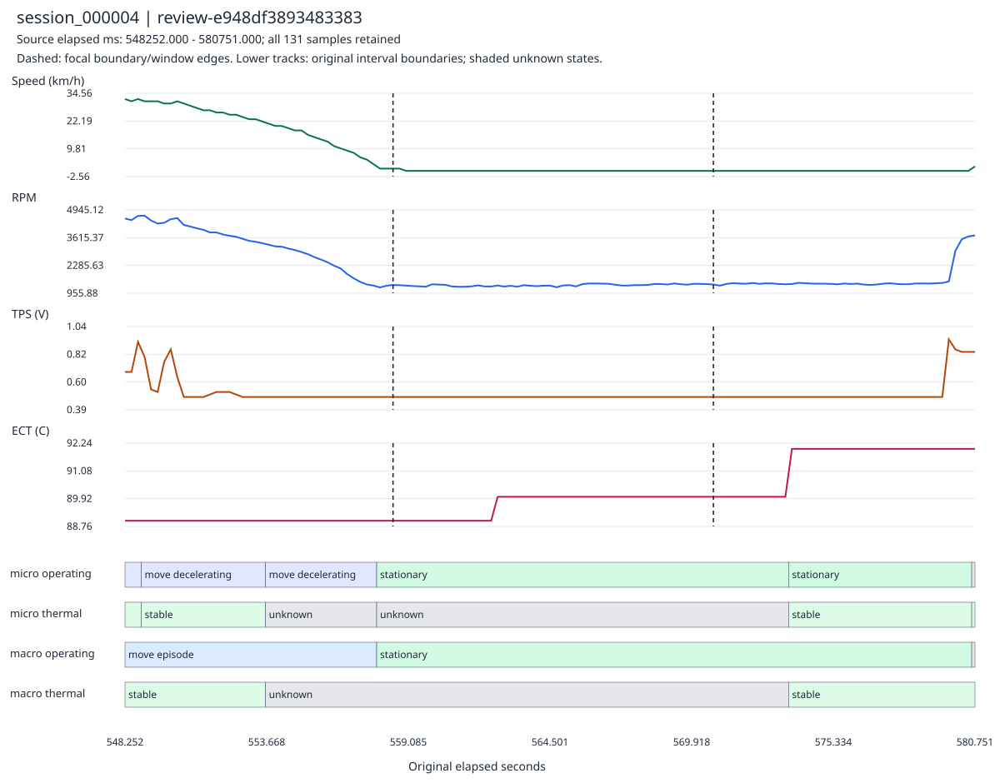

| Track | Label | Original Interval s | Interval ID |
| --- | --- | --- | --- |
| micro_operating | moving_variable | 543.8760-548.8750 | `auto_suggest_35d5cb9b5c93a606949d` |
| micro_operating | moving_decelerating | 548.8750-553.6265 | `auto_suggest_e9767ba6b47dd5007da5` |
| micro_operating | moving_decelerating | 553.6265-557.8750 | `auto_suggest_1d4490ce9af7b5490bf9` |
| micro_operating | stationary_running | 557.8750-573.6260 | `auto_suggest_e9113a1e753d3c9b40c9` |
| micro_operating | stationary_running | 573.6260-580.6260 | `auto_suggest_d01e00a23d0630128874` |
| micro_operating | unknown | 580.6260-581.1260 | `auto_suggest_9d775ccc6bdd84a13fc0` |
| micro_thermal | stable | 543.8760-548.8750 | `auto_suggest_35d5cb9b5c93a606949d` |
| micro_thermal | stable | 548.8750-553.6265 | `auto_suggest_e9767ba6b47dd5007da5` |
| micro_thermal | unknown | 553.6265-557.8750 | `auto_suggest_1d4490ce9af7b5490bf9` |
| micro_thermal | unknown | 557.8750-573.6260 | `auto_suggest_e9113a1e753d3c9b40c9` |
| micro_thermal | stable | 573.6260-580.6260 | `auto_suggest_d01e00a23d0630128874` |
| micro_thermal | stable | 580.6260-581.1260 | `auto_suggest_9d775ccc6bdd84a13fc0` |
| macro_operating | moving_episode | 428.6260-557.8750 | `macro-100ff4c5c125cc804e73178a` |
| macro_operating | stationary_running | 557.8750-580.6260 | `macro-c7ffef1510ffb79bd6978167` |
| macro_operating | unknown | 580.6260-581.1260 | `macro-f5b6cd3b81865d7e108e172b` |
| macro_thermal | stable | 428.6260-553.6265 | `macro-e3eb9006ebb4c60e14c94e6d` |
| macro_thermal | unknown | 553.6265-573.6260 | `macro-c11087e5b3e8c92145611378` |
| macro_thermal | stable | 573.6260-596.8750 | `macro-91d3545d7e86fbcbd811bb70` |

Action: **pending**. Human review seconds: **not recorded**.
